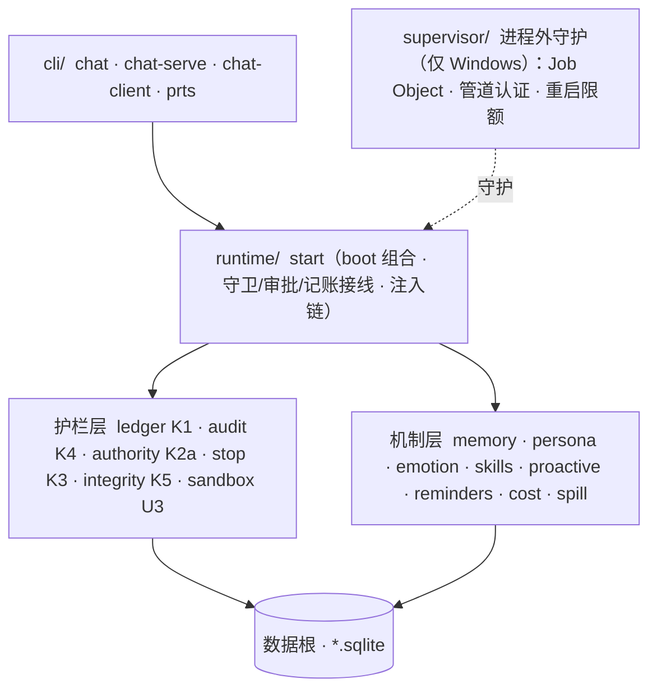

# prts-system

**PRTS 的受保护核心。** 任务账本、审计链、权限入口、启动完整性、分级停止、运行沙箱，以及把这些接进 DSH 运行时的入口。

纯 TypeScript，`node:sqlite` 持久化，只追加哈希链事件 + 可重建投影。运行时以 DSH 为底座，Cordis 插件框架由 DSH 维护，本仓不自研。

这个仓不是 PRTS 全体。产品目标、能力表与首版验收判据在 `docs\reference\`（两份：项目章程、架构需求）；界面与桌面端在另仓。有一条判断要一直记着：**机制存在 ≠ 验收通过**——「有代码且有调用方」和「有真实流程证据」是两件事，逐项对照在 `docs\TODO.md`。

## 分层



| 层 | 职责 | 目录 |
| --- | --- | --- |
| 护栏层 | 结构上不许绕过的那层：账本、审计、授权判定、分级停止、启动完整性、沙箱 | `src\ledger\` `src\audit\` `src\authority\` `src\stop\` `src\integrity\` `src\sandbox\` |
| 机制层 | 四方向的机制：记忆、人格、情感、进化，加前瞻、提醒、费用、输出卸载 | `src\memory\` `src\persona\` `src\emotion\` `src\skills\` `src\proactive\` `src\reminders\` `src\cost\` `src\spill\` |
| 运行时 | 把上面两层接进 DSH：boot 组合、工具面、注入链、所有者通道 | `src\runtime\` |
| 入口 | 所有者 REPL、服务端、分离客户端、`prts` 子命令 | `src\cli\` |
| 共享原语 | 哈希链（canonicalJson / sha256hex / chainHash / verifyChainRows） | `src\chain\` |

新组件复用 `src\chain\` 的链原语，不要各自实现一遍哈希链。

## 跑起来

Node 24（本机实测 24.19.0）。持久化依赖 `node:sqlite`，低于 22.5 无法运行。

```sh
npm install
npm run typecheck      # tsc -p .（strict + noEmit + erasableSyntaxOnly）
npm test               # node --test，164 个测试文件
npm run verify:memory  # V1-17 检索回归：低于冻结基线即退出码 1（零容差）
npm run verify:e10     # E10 硬门：四臂全部符合才 exit 0，这是所有者通道唯一的安全判据
```

最小可用是进程内 REPL。三个环境变量缺任一直接退出——不猜默认值：

```sh
PRTS_DATA_ROOT=C:\prts-data PRTS_WORKSPACE=C:\prts-workspace \
PRTS_CONFIG=C:\prts-system\config\prts.yml npm run chat
```

输入消息开始对话，`/exit` 退出，Ctrl-C 中断当前轮次（见下方命令表）。

**API key** 按「被随手读到的门槛」从高到低取第一个可用的：

1. **Windows 凭据管理器**（推荐，磁盘上无明文）：`npm run secret:set` 交互输入（不回显），`npm run secret:del` 删除；存好可删掉明文文件。
2. **环境变量** `DEEPSEEK_API_KEY`：读到后立刻从本进程环境删除，防派生子进程继承。
3. **明文文件** `<dataRoot>\secrets\deepseek.key`：兼容保留，启动时打印警告——模型 shell 用 `Get-Content` 就能读走它。

诚实边界：同用户下的任何持久化存储都可能被同用户的恶意进程提取。这套方案消除的是「明文文件可被随手读」，不是「同用户主动提取」。

**所有者通道**（运行时与客户端分离）：

```sh
npm run chat:serve     # 起运行时 + 命名管道；端点原子发布到 <dataRoot>\terminal.endpoint
npm run chat:remote    # 另开终端，PRTS_DATA_ROOT 指向同一数据根
```

客户端不解析命令语义（`/accept`、`/tasks` 一律当普通文本发给服务端），意外断开自动重连并重读端点文件（服务端重启会换管道名）；`/exit` 是主动结束，不重连。服务端常驻：客户端断开只结束本代会话，运行时与 agent 不退。

## 模型能调什么

模型能调的工具 = DSH 插件提供的 + PRTS 自己注册的。权威清单看代码，不要抄文档：`grep -rn "name: 'prts_" src`。

- **PRTS 自有工具**（当前 13 个 `prts_*`）：任务（`prts_task_create` / `prts_task_list`）、记忆（`prts_memory_recall` / `prts_memory_summarize`）、会话（`prts_session_recall` / `prts_session_archive`）、意图（`prts_intent_create` / `prts_intent_list`）、技能（`prts_skill_propose` / `prts_skill_list`）、分派（`prts_subtask`）、联网（`prts_web_search` / `prts_web_fetch`）。模型只能建 `draft` 任务，不能自己批准、不能自己激活。
- **DSH 插件工具**（`config\prts.yml`）：`read` / `read_image` / `write` / `edit`（经 K2a 守卫）、`glob` / `grep`（ripgrep 后端）、`working_directory`（只切会话 cwd，不产生能力）、`pwsh`（win32）/ `bash`（非 win32，互斥）。
- **写前必读**：`write` 新建放行；覆盖会话从未接触过的已存在文件被拒（`FS_NOT_OBSERVED`）；`edit` 必须先读，读过后文件被外部改动会报 `FS_STALE_VERSION`。回归见 `test\runtime\fs-tools.test.ts`。
- **模型侧不接受 actor 入参**：actor 在工具内部写死为 `{ kind: 'model', sessionId }`；属于 owner/system 的固定通道没有任何工具封装。

## owner 命令

宿主命令不触发模型回合，走 owner 通道：

| 命令 | 作用 |
| --- | --- |
| `/task <目标>` | 提一个 `draft` 任务 |
| `/task-approve [taskId]` | 批准本会话待批的任务（省略 id 时用本会话最近一个 draft） |
| `/tasks` | 列账本里的任务 |
| `/accept [taskId]` · `/reject <理由>` · `/cancel [taskId]` · `/budget [JSON]` | 裁决与预算；省略 taskId 时作用于本会话进行中的任务 |
| `/memory <检索词>` | 检索长期记忆 |
| `/forget <id,...> [--yes]` · `/forget-session <sessionId,...> [--yes]` · `/correct <factId> <新内容>` | 记忆删除与纠正 |
| `/intent [list [--all] \| cancel <id,...>]` | 前瞻意图 |
| `/persona [预设名]` | 人格预设；切换后需重启 `prts chat`（人格在启动时装配） |
| `/skill [list [--all\|active\|retired\|rejected] \| show <id> \| eval <id> <结论> <依据> \| adopt\|reject\|retire\|restore <id> [理由]]` | 技能库（V1-09）：默认列待评估候选；采用后**下一轮**就注入，不用重启 |
| `/model <预设名>` | 模型后端；切换后需重启 `chat:serve`（窗口在启动期定） |
| `/sandbox <view\|edit\|full>` | 沙箱档位，per-session |
| `/sessions` · `/switch <sessionId>` · `/new` | 会话表、切到已存在的 live 会话、新建会话 |
| `/dispatch <任务>` | 分派给 worker，只回摘要 |
| `/exit` · `/quit` | 退出 |

## 目录

```
src\
  chain\        共享链原语，新组件复用
  ledger\       K1 任务账本：append-only 事件 + fold.ts 投影
  audit\        K4 审计：同一 DB、独立表、独立链
  authority\    K2a 授权：Authority.guard 是唯一强制点（同步，返回理由串即拒绝）
  stop\         K3 分级停止 StopController
  supervisor\   K3 进程外守护：Job Object、控制管道认证、崩溃重启限额
  integrity\    K5 启动完整性：受保护包与源码树哈希，锚在审计链
  sandbox\      U3 运行沙箱：AppContainer / ACL runner
  core\         startup-check 双链校验 + initCoreDb
  memory\       长期记忆：写入 / 巩固 / 检索 / 纠正 / 遗忘 / 向量索引
  persona\      人格预设      emotion\  情感状态      skills\  进化：候选 / 评估 / 采用 / 回退
  proactive\    前瞻回忆      reminders\ 任务提醒        cost\    费用计量
  spill\        工具输出卸载：超阈值落文件，read 可回读
  runtime\      start.ts（boot + 接线）、assembly.ts（注入链）、task-tools、subtask、
                terminal-server、owner-protocol、各 *-tools、tool-loop-guard
  cli\          chat（REPL）、chat-serve、chat-client、prts（upgrade / memory / emotion / archive）
config\prts.yml 运行时组合树（sdk-minimal 展开，剥掉 sdk-app 与账户链）
test\           164 个测试文件；test\support\ 是驱动、脚本化模型替身、临时目录
```

## 数据根

运行时只认 `PRTS_DATA_ROOT`，所有状态都在这个目录下：

| 路径 | 内容 |
| --- | --- |
| `core.sqlite` | K1 账本 + K4 审计（独立表、独立链） |
| `memory.sqlite` | 长期记忆：片段、事实、向量索引、巩固与纠正记录 |
| `persona.sqlite` | 人格预设与当前 active |
| `skills.sqlite` · `emotion.sqlite` · `proactive.sqlite` · `reminders.sqlite` · `cost.sqlite` | 各机制自己的库 |
| `model-profile.json` | `/model` 写入的后端预设，`chat:serve` 启动时读并覆盖 env |
| `terminal.endpoint` | 所有者通道的管道名（listen 成功之后才原子发布） |
| `secrets\deepseek.key` · `secrets\firecrawl.key` | 兜底明文密钥（读到即告警） |
| `dsh-home\sessions\**` | DSH 会话日志（jsonl）：`/sessions`、回放、流式兜底都读它 |

工具输出卸载（spill）默认落在数据根的同级目录 `prts-spill`（`PRTS_SPILL_ROOT` 可改）。

## 必须守住的不变量

1. **守卫是唯一强制点**。`pre-execute` 瀑布与审批应答都可能被前置插件伪造，`Authority.guard` 在后面仍会拒。它同步、与 DSH `tools.guard` 同签名、返回理由串即拒绝，且每次直查 SQLite——跨进程撤销即时生效。当前覆盖 `fs.read:` / `fs.write:` / `fs.delete:` / `net:`。
2. **真实运行时必须在派生任何子进程之前调用 `connectControl`**，并把 `PRTS_CONTROL_*` 从 env 读即删——否则模型 shell 经继承的环境变量就能冒充运行时。
3. **所有者命名管道只接受 `stop` 和 `status`**，其余一律 `UNSUPPORTED`，畸形 JSON 不崩守护进程。控制管道连接须在 2s 内发送 `{type:'hello',pid,token}` 认证：token 每次重启换新、`timingSafeEqual` 比对、pid 必须等于 Job 内运行时 pid，先认证者胜。
4. **key 只存在于内存 credentials 服务**：不进环境变量，不落模型可读的位置。
5. **账本与审计是事实来源**。`tasks` / `task_steps` / `evidence` 只能由 `src\ledger\fold.ts` 的 `applyEvent` 更新，`audit_deletions` 只能由 `src\audit\fold.ts` 的 `applyAuditEvent` 更新；每个变更是「追加事件 + 应用投影」在同一个 SQLite 事务内完成。
6. **`startupCheck` 返回 `read-only` 时不得调用 `initCoreDb`**，只能只读打开（写方法一律抛 `READ_ONLY`）。断链或缺表就进只读，不修、不猜。
7. **owner 通道不暴露给模型**：`verify` / `ownerAccept` / `ownerReject` / `setBudget` / `stopByOwner` / `resumeFromStop` / `chargeUsage` / `recoverOnStartup` 的 actor 由库内固定；工具适配层只能把 actor 固定为 `{ kind: 'model', sessionId }`，本库不验证 actor 的真实来源。
8. **只用可擦除语法**：不要 `enum` / `namespace` / 参数属性 / `import =` / 装饰器；本地导入一律带 `.ts` 后缀——Node 原生类型剥离直接运行 `.ts`。

## 状态

- **测试**：`npm test` 本机实测 **888 passed / 0 failed**，98s（2026-11-07，164 个测试文件）。
- **实现 vs 验收**：初版 17 项全部有实现；验收完成 9 项、部分 2 项、待博士盲评或外部条件 6 项。逐项判据与证据见 `docs\TODO.md` §A。
- **本机部署事实（2026-11-06 实测）**：K5 从未在 `C:\prts-data` 锚定——没有 manifest 文件、`core.sqlite` 无 `integrity.*` 事件、`prts chat` 不经过 Supervisor。要启用得先用 `prts upgrade --init` 做首次锚定（还要带 `--install-root` / `--manifest` / `--db` / `--spec` 四个参数），此后每次改 `src\` 都要重跑，且要有消费方给 `Supervisor.start` 传 `config.integrity` 才真的校验。在那之前「改 src 就要跑 upgrade」在本机不成立。
- **沙箱默认**：代码默认 `PRTS_SANDBOX_BACKEND=local`；部署脚本 `prts-chat.cmd` 已设 `appcontainer`（部署层已切，代码默认未改）。

## 边界（实测结果，不是待办）

- **沙箱三档**：`/sandbox view|edit|full` → `read-only` / `workspace-write` / `danger-full-access`，写 `sandbox/mode` 会话事件（per-session，随会话日志回放重建）。切档会先 kill 活 PTY——持久 shell 只在起 shell 时 confine 一次。`view` 档下 fs 写/删由 `src\runtime\start.ts` 直接拒：本地 fs 后端不消费 `sandboxPolicy`，不在这里拦就名不副实（实测过：切 view 后 `write` 照写不误）。
- **后端差异是真实的**：`local` 走 `dsh-sandbox-windows-acl` 的 WRITE_RESTRICTED token，本机实测**连 `C:\prts-workspace` 都写不了**；`appcontainer` 下真机三臂通过——工作区内写成功、工作区外写失败且文件未创建、读密钥被拦（`test\sandbox\live-wiring.test.ts`）。要能写工作区就用 appcontainer。
- **`pwsh` 的命令体不归 K2a**。守卫识别不了命令体内的写删，对 `exec` / `net` / `system` 只能整体放行或整体拒绝；判定分工放在 OS 层（沙箱）。`src\runtime\start.ts` 里显式过滤 `exec` / `tool` / `system` 是分工，不是遗漏。设计见 `docs\k2b-exec-boundary-design-2026-11-05.md`。
- **E3 审批覆盖 `fs.*` 与 `net`**，不覆盖 `exec` / `system` / `tool`——pwsh 命令体内的写删识别不了，整体拒绝会切掉现有能力。只有 `decide()` 返 `ask` 才问人：`allow` 原样放行，`deny`（如 `protectedRoots`）不可审批，交回同步守卫去拒并落 `tool.denied`。三层授权语义：`protectedRoots` 内恒 `deny`，工作区外且非 protected 为 `ask`，工作区内 `allow`；优先级 `deny > ask > allow`。
- **请求重试会重复输出片段**：失败重试会起新 attempt 从头重发 delta，已经写进终端的片段撤不回来。正常对话（无错误、无工具重试）不触发。
- **停止权与进程外守护仅 Windows**（Job Object + 命名管道）；其他平台只有进程内的 `StopController`。

## 文档

| 想去哪 | 读什么 |
| --- | --- |
| 改代码前先认规则 | `AGENTS.md`——工具层接线事实、沙箱、所有者通道、K6 组合、外部参考与选型规则 |
| 实现到验收的差距 | `docs\TODO.md`（§A 对照表）、`docs\PENDING-2026-11-05.md` |
| 产品目标与第一版范围 | `docs\reference\` 两份原文 |
| 各段工作交接 | 不进仓库——本地 `docs\HANDOFF-2026*.md`（最新 `HANDOFF-20261106-session-h.md`） |
| 设计与专项调查 | `docs\` 下的 `design-*` / `memory-*` / `v1-*` |
