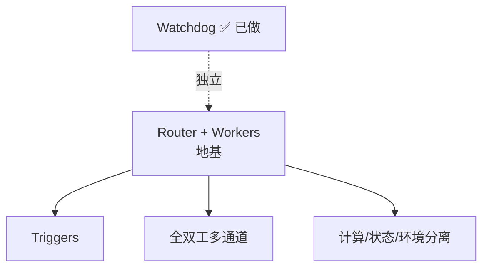

# 会话交接（2026-11-04 第四段）

**写给完全没有上下文的新会话**：本文自包含，不引用任何未落字的对话。

**范围**：11 个提交。三块新模块（V1-07 主动回忆、③ token 预算、W3 任务提醒）、V1-16 费用计量、Watchdog（含对 super-agent 架构的实测调研与方向决定），以及四处工程质量修复。

**起点**：上一个会话交接于 `3ddfbd6`，当时 629 测试、上下文装配 ⑦ 已完成。

---

## 一、当前状态（2026-11-04 实测）

| 项 | 值 | 证据 |
|---|---|---|
| HEAD | `e849190` | `git log --oneline -1` |
| 分支 | `main` | — |
| 工作树 | tracked 干净；未跟踪项只有 `.rivet/`、`nul`、`.scratch/` | `git status --porcelain` |
| 全量测试 | **701 pass / 0 fail**，exit=0（47.4s） | `node --test "test/**/*.test.ts" > log 2>&1; echo exit=$?` |
| 类型检查 | `tsc -p .` exit=0 | `npm run typecheck` |

**测试命令务必照抄**：`node --test` 的输出重定向到文件后再取退出码，**不要用管道**（管道会让 `$?` 变成 `grep` 的退出码，测试挂了也显示通过——上个会话踩过）。

---

## 二、本会话 11 个提交

| 提交 | 内容 |
|---|---|
| `f5793e1` | 修 `subagent-session.test.ts` 的 300ms 竞速（等落盘改为轮询文件出现） |
| `e4a02f4` | 修 `tmp.ts` 清理重试：`rmSync` 的 `maxRetries` **对文件级 EPERM 不生效**（探针实测 elapsed=0ms），改为自己轮询 |
| `cae30f5` | `runtime.test.ts` 同步等待点加超时（`execFileSync` 60s、R6 dispose 15s） |
| `e4969c2` | **V1-07 主动回忆**：`src/proactive/` + `proactive-recall.ts` + 接线 + 28 测试 |
| `5334ca2` | **③ token 预算**：`src/runtime/token-budget.ts` + 接入 `memory-inject` |
| `be4dfd3` | **W3 任务提醒**：`src/reminders/` + `task-reminder.ts` + 接线 + 14 测试 |
| `7edee6b` | **V1-16 费用计量**：`src/cost/` + 从 `assistant-stream` 的 usage chunk 记账 |
| `f114b67` | 修 `supervisor.test.ts` 认证用例的 S2 窗口（1000ms → 产品默认 5000） |
| `531feec` | `appcontainer.ts` 管道读改为有界等待（`PeekNamedPipe` + 30s 预算）；`workspace-acl.test.ts` 6 处 `execSync` 加 30s 超时 |
| `e7960dd` | profile 创建加跨进程 Mutex（并发创建变排队，缓解非根治） |
| `e849190` | **Watchdog**：运行时心跳 + Supervisor 进程外检测「活着但卡死」→ 强杀重启 |

---

## 三、super-agent 部分（重点）

### 3.1 GitHub 实测事实（2026-11-04，走代理 `127.0.0.1:7892` 查的，不是归档）

| 项 | 值 |
|---|---|
| 仓库 | `deepseek-ai/dsh-superagent-prototype`（MIT），`main` 单分支 |
| commit | **只有 1 个**：`8c32a9dc5d`（2026-10-31），`pushed_at` 2026-11-03 |
| 体积 / 热度 | **37 KB**，18209 stars |
| README 自述 | 「Research prototype for reference only, **not an official DeepSeek product**」；「**not identical to … the implementation described in *Exploring Super-agent Design***。Some designs discussed in the article are **directions for future development and are not implemented in this prototype**」 |

**结论**：仓库本身是 37KB 的样例，**真正的架构在文章里**——《Exploring Super-agent Design: Towards a More Autonomous Agent System》，2026-11-01 由 DeepSeek Harness 团队发布（X 上 8.2 万浏览）。

**本机查 GitHub 的前提**：代理端口当前是 **7892**（不是 7890，会变，用前先 `netstat` 探或看系统代理设置）。`curl -x http://127.0.0.1:7892 ...` 可用；直连 TLS 握手失败。

### 3.2 文章的五模块架构

| 模块 | 内容 | PRTS 现状（本会话结束时） |
|---|---|---|
| **Router + Workers** | 一个长期 Router 会话管人话与分派，多个隔离 Worker 会话并行干活；Router 只分派、Worker 只执行 | **不做**（`design-superagent-fusion.md` 第四节） |
| **Triggers** | 事件驱动（GitHub / 飞书 / CI），两阶段过滤（代码规则 → 模型研判） | 不做（输入只有人对话） |
| **全双工多通道** | 工具跑着也能说话，按渠道调语气 | 不做 |
| **计算/状态/环境分离** | 会话存数据库、loop 在云、经本地 daemon 触达休眠机器 | 不做（单机） |
| **Watchdog** | 进程外控制环，定时唤醒，问两件事：**是否活着** + **是否在推进**；用模型判断 Worker 是否跑偏 | **已做**（`e849190`，心跳版） |

文章的量化结论：Router 方案 p50 12.4min vs 单会话 20.4min、p95 15.7 vs 29.5；代价是 token 从 6.1–10.8M 涨到 23.2M（cache-read）。

### 3.3 博士的决定（2026-11-04）——**这一条推翻现有设计文档**

> 「五个模块都有做的打算」

**这直接否定了 `docs/design-superagent-fusion.md` 第四节的「不做常驻 Router」**（三条理由里，第 1 条「产品形态里没有瓶颈」被推翻）。**该文档需要改**，否则下一个人读到会以为方向没变。第 3 条（无真实负载时编排层正确性无法验证）**仍然成立**——它是对实现顺序的约束，不是对目标的否定。

### 3.4 已做：Watchdog（`e849190`）

**机制**：

```
运行时                           Supervisor（进程外）
  │ 每 5s 发 {type:'heartbeat'} ──→ 更新 lastHeartbeatAt
  │                                  │ poll() 每 200ms 检查
  │ （同步阻塞 → 定时器停摆）          │ 超过 15s（3 倍）没收到
  │                                  ↓
  │                             判定卡死 → 强杀 → 重启（受 maxRestarts 限额）
```

- 心跳走**已有控制管道**，不新增文件/端口；间隔由 Supervisor 通过 `PRTS_HEARTBEAT_MS` 注入，两侧同源。
- 运行时侧在 `connectControl` 里起 `setInterval`（`unref`，不阻止退出）。
- **`terminate` 后 `exitCode()` 不保证及时反映**（实测：Job 已空但 `exitCode()` 仍 `undefined`，重启永远不发生）——所以 Watchdog 路径**不依赖 exitCode**，同步完成「杀 → 置空 → 重启」。`poll()` 的退出码路径保留，两者共用 `restartAfterDead()`。
- 参数：`timeouts.heartbeatMs`（默认 5000）、`timeouts.heartbeatTimeoutMs`（默认 3 倍）。

**实测证据**（`FAKE_MODE='freeze'`，即连接但不发心跳）：

```
heartbeat timeout (772ms > 600ms) — escalating S3
runtime dead (heartbeat-timeout); restarting (1/3)
...restarting (2/3)... (3/3)
→ state=failed（限额耗尽）
```

测试 `test/supervisor/watchdog.test.ts`（2 条）：WD1 验证「检测 → 重启 → 限额耗尽转 failed」，WD2 验证正常心跳 3s 不误判。

**边界**：

- **默认 15s 才判定**：挂起从「永久」变成「卡 15 秒后可恢复」，不是「不卡」。
- **不修根因**：同步 ffi 仍会卡，只是卡完能恢复。
- **重启后可能再次卡**：同一处 ffi 在同样条件下会再次挂，直到 `maxRestarts`（默认 3）耗尽转 `failed`。
- **只看「停摆」，不看「跑偏」**：super-agent 的 Watchdog 用模型判断 Worker 是否在有效推进；PRTS 这个只看心跳有没有停。对同步阻塞够用，对「模型空转」不够。

### 3.5 剩余四模块的前置与依赖



**Router + Workers 是地基**，另外三个都挂在它上面。开工前必须先回答三个问题：

1. **常驻进程的生命周期谁管**——现在的 `Supervisor` 是天然的候选（它已经是进程外、有 Job、有 S0–S3、现在还有 Watchdog）；
2. **会话状态存哪**——DSH 的 session 库（`dsh-home/sessions`），还是另建；
3. **人怎么切任务**——现在只有 `/task` `/intent` `/memory`，Router 需要「列出活跃会话 + 切过去」的入口。

**PRTS 已有的可复用件**：`agents.create` 的多 agent 并存（`test/acceptance/subagent-session.test.ts` 已证机制可用，含血缘落盘与独立回收）；`Supervisor` 的进程级管理。

**注意一个已被否决的坑**（`design-superagent-fusion.md` 否决清单）：
- 不能用 `delegationDepth` 当递归预算（框架只做格式校验，没有上限逻辑）；
- 不能让子会话继承父会话的授权（破坏「授权判定按 sessionId」这条安全不变量）；
- 不能复用 `memory.origin` 标 subagent（该列 CHECK 是 `'live' | 'benchmark'`，语义是数据来源）。

### 3.6 一个必须记住的外部事实

**super-agent 的 Worker 不是独立进程**——文档原文：「Executor Sessions run commands without approval as the operator's OS user」（`docs/003-execution.md`）。它是 DSH 的**进程内 Session**，隔离靠 preset + 权限 + 工具集。

**所以「采用 super-agent 架构」不能解决 PRTS 的同步阻塞问题**，也不能照搬它的「隔离」来当安全边界。

---

## 四、工程质量：全量偶发挂起

### 4.1 现象与数据

| 实验 | 挂起率 | 现场 |
|---|---|---|
| 修复前（20 轮） | 1/20 | `workspace-acl.test.ts`，90s，cpu 2.6s，**有**孙进程 |
| `execSync` 加超时后（15 轮） | 1/15（第 15 轮） | 同文件，87s，cpu 2.8s，**无**孙进程 |
| profile Mutex 后（15 轮） | 1/2（第 2 轮） | 同文件，90s，cpu 2.5s，**无**孙进程 |

**三次现场高度一致**：同一个文件、CPU 只用 2.5–2.8s、无子进程 → 卡在**进程内的同步 ffi**。

### 4.2 已消除的三个阻塞点（都是净改进）

1. `workspace-acl.test.ts` 6 处 `execSync` 无 timeout（`whoami`/`git`/`icacls`/`mklink`）→ 全部 30s；
2. `appcontainer.ts` 的 `drainPipe` 读管道直到 EOF（孙进程持有写端就永久阻塞）→ `PeekNamedPipe` 有数据才读 + 30s 总预算；
3. profile 创建加跨进程 Mutex（并发创建变排队）。

### 4.3 仍未根治

**根因指向 `CreateAppContainerProfile` / `DeleteAppContainerProfile`**——koffi 同步 ffi，JS 层无法加超时。Mutex 只串行化了创建，且持有者自己挂起时排队者 15s 后无锁硬上。

**兜底**：`e849190` 的 Watchdog 让「永久挂起」变成「15s 后可恢复」。

**剩余路径（按成本排序）**：
1. **串行化 sandbox 测试**（最低成本）：让 `appcontainer.test.ts` 与 `workspace-acl.test.ts` 不并发跑，或合并成一个文件；
2. **把 profile 操作放进可 kill 的子进程**：父进程 `taskkill /T /F` 兜底，代价是每次创建多一次进程派生；
3. **procdump 抓栈**确认具体卡在哪个 Win32 调用。

---

## 五、未做清单（更新到本会话结束）

### 完全零覆盖

| 条款 | 缺口 | 外部依赖 |
|---|---|---|
| **V1-11 终端与语音** | 按键说话/播报/打断，src 零命中 | 音频栈，受环境限制 |
| **V1-02 第二家模型提供方** | config 只有 `deepseek-official` | 第二个 API key |
| **V1-17 公开记忆基准** | 只有自建离线 38.1% | 数据集已锁定，基线未跑 |
| **V1-18 宿主 vs 自管对比** | 无实现 | 依赖 ② 通道选型 |

### 机制在、缺内容或人工验收

- **V1-03/04 人格文本**——待博士审定（架构需求 §10 第 7 条）
- **V1-05 情感 10 个情境样本**——人工验收
- **V1-15 元记忆**——「主题目录 section」待建，「问没有的事如实说不记得」未验
- **V1-07 的 70% 恰当率**——需 7 天真实使用

### 架构缺口

- **② 装配顺序**——机制已定位（DSH 原生末尾追加），「打开后生效」未验
- **⑥ 子任务上下文（W2 `prts_subtask`）**——真实前置是**先给 `authority` 加子会话收窄授权**（父会话持久 grant 静默继承、工作区 `fs.write` 走 `via:'policy'` 无条件放行）
- **H3 shell 读隔离**——待架构决策
- **③ 的注入上限默认值**——未标定（当前默认不裁）

### super-agent 剩余四模块

Router + Workers、Triggers、全双工、环境分离（见 3.5）。

---

## 六、接手第一件事

```bash
cd C:/prts-system
npm run typecheck
node --disable-warning=ExperimentalWarning --test "test/**/*.test.ts" > /tmp/t.log 2>&1; echo "exit=$?"; grep -E "^ℹ (tests|pass|fail)" /tmp/t.log
```

期望：exit=0、**701 pass / 0 fail**。

两条都绿之后，按博士已定的方向，**下一步是 Router + Workers**（3.5 的三个前置问题必须先回答，不要直接写代码）。

---

## 七、踩过的坑（本会话新增，会复发）

1. **`rmSync` 的 `maxRetries` 是假兜底**：它只覆盖目录删除相关错误；文件被独占打开（如 `node:sqlite` 的库文件）时 **0ms 直接抛 EPERM**，重试参数从未进入。必须自己轮询（`test/support/tmp.ts` 已改）。
2. **`execSync` 无 timeout 会永久挂**：高并发下 `git`/`icacls`/`cmd` 等文件锁，同步等待连 `node --test` 的 120s 超时都不触发（事件循环停摆）。**所有测试里的同步子进程调用都要带 timeout**。
3. **`terminate` 后 `job.exitCode()` 不保证及时反映**：Job 已空（`isEmpty()=true`）但 `exitCode()` 仍 `undefined`，依赖它的重启逻辑永远不触发。判死要走独立路径。
4. **`interference_search` 需要会话级 `ultar-mode`**：会话过期后再调用会返回 `SEARCH_DISABLED`，按普通方式实现即可。
5. **代理端口会变**：本会话实测是 `7892`（历史有 7890/7892/31181）。查 GitHub 前先 `netstat -ano | grep -E ":(7890|7891|7892)"` 或看系统代理设置。
6. **GitHub 上只有 1 个 commit 不代表没更新**：`pushed_at` 可能比最后一个 commit 晚（force-push / 分支活动）。要判断「有没有新东西」，看 `pushed_at` + 分支列表 + README，别只看 commit 数。

---

## 八、证据边界（不要当成已验证）

- **Watchdog 只在 fixture 上验证过**（`FAKE_MODE='freeze'`），没有在真实 runtime 的同步 ffi 挂起上端到端验证。
- **V1-16 的单价默认全 0**：不配置 `PRTS_PRICE_*_PER_M` 时只记 token、金额记 0。巩固账户恒为 0（本地 Ollama 无 API 账单）。
- **V1-07 / W3 的阈值与参数都没有真实数据**（7 天试用、2 小时停滞阈值），全部是设计口径。
- **③ 的预算默认不裁**（窗口 1M → 预算 989K，注入约 1K）。
- **super-agent 的架构描述来自文章与第三方解读**，仓库只有 37KB 样例；文章自述「部分设计未实现」。
- **Router 方案的量化收益（p50 12.4 vs 20.4min）来自 DeepSeek 的合成测试**，不是 PRTS 的负载。
