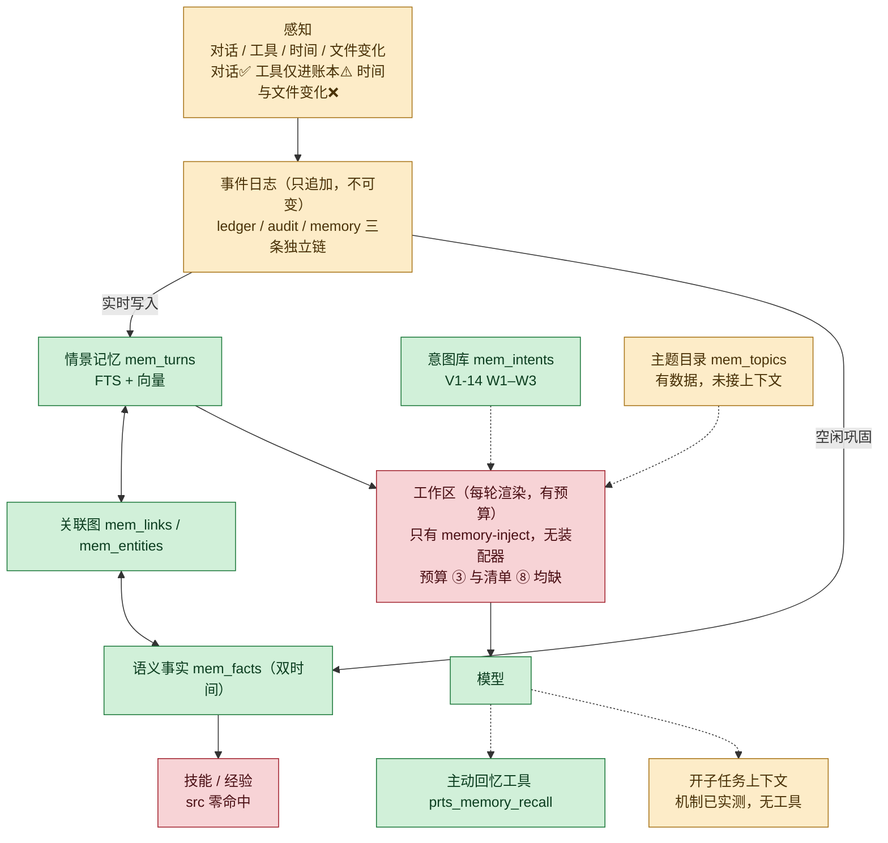

# 工作区装配（上下文）：对账与切片

2026-11-03。依据 `docs/reference/PRTS-ARCHITECTURE-REQUIREMENTS-2026-10-29.md` §5.3
「工作区装配（上下文）」七条原文（0.6 版，`diff --strip-trailing-cr` 与仓外正本一致）。

结论先写：**七条里做了两条半**。⑤工具结果卸载完成，④压缩借用 DSH，①宿主装配有一半。
缺的是 ②排序 ③预算 ⑥子任务。⑦ 与 ⑧ 已补（2026-11-03，见下表与第三节）。

---

## 一、逐条对账

| # | §5.3 要求 | 现状 | 判定 |
|---|---|---|---|
| ① | **宿主装配为主，模型自管为辅**。每轮由宿主按规则确定性装配；模型深挖时调主动回忆工具；不采用完全由模型换页 | 宿主注入在：`src/runtime/memory-inject.ts`（每轮检索 5 条 + 精排 + 更正钉住 + 向量路）；主动回忆工具在：`prts_memory_recall`（`src/runtime/memory-tools.ts`）。**但没有「装配器」**：没有代码按规则决定这一轮装哪些材料 | ⚠️ 半 |
| ② | **装配顺序按稳定程度排列**：人格、主题目录等稳定内容在前，对话与检索结果在后，以提高提示缓存命中率 | 现状相反：检索结果被塞进 `role:'user'` 的消息流（`memory-inject.ts:21`）。**但 DSH 原生有正确形状**：动态上下文追加在消息末尾（`dsh-agent-loop/lib/index.js:913-918`），只是被 `config/prts.yml:103` 关着；「打开后生效」未验，见第五节 | ❌ 缺，机制已定位、生效未验证 |
| ③ | **预算** = min(配置上限, 模型窗口 − 输出预留 − 安全余量)；未知窗口不按无限处理 | 只有条数上限 `limit: 5`（`memory-inject.ts:127`）。窗口：`config/prts.yml:20` `defaultContextWindow: 1000000`（可由 `DSH_CONTEXT_WINDOW` 覆盖）。没有 token 预算层 | ❌ 缺 |
| ④ | **压缩**：先移低相关材料与可回读原文，再压旧对话；保留指向原文的引用，不反复摘要 | `compaction-basic`（`config/prts.yml:52-53`）与 `compaction-image-offload`（`:55-56`）已加载，均无 config（走默认阈值）。「保留引用、不反复摘要」是否符合未验 | ✅ 借用，语义待验 |
| ⑤ | **工具结果卸载**：大结果存对象存储，工作区只放引用、摘要与关键片段，需要时分页读取 | `src/spill/`（encode / policy / retention / store / types / wiring），`start.ts:25` 引入 `attachSpill` / `resolveSpillRoot`，`:166-176` 有容器授权接线的注释。设计见 `docs/design-tool-output-spill.md` | ✅ 完成 |
| ⑥ | **子任务上下文**：长任务子步骤在干净上下文执行，只交回结论与产物引用 | 无。机制层已实测可用（`test/acceptance/subagent-session.test.ts`），工具层没有。见 `docs/design-superagent-fusion.md` W2 | ❌ 缺 |
| ⑦ | **跨会话连续**：新会话从任务账本、意图库、近期情景记忆与关系记忆重建「上次聊到哪里」，不整体塞上一段聊天 | `src/runtime/session-recall.ts`（`attachSessionRecall`），接在 `start.ts` 的 pre-step 链末位。三源：未结任务（draft/active/paused/blocked/verifying，按 `updatedAt` 倒序，下一步取 `resume.next`，为空退回末条 step 名）、待触发意图（`listIntents({status:'pending'})`）、近期情景（新增 `store.recentTurns`，跨会话按发生时刻倒序，排除当前会话）。每会话只开一次场；三段各自 try/catch，全空则不注入。**关系记忆未做**——它属 V1-05（`docs/design-memory-v1.md:58` 已定「不做」），只留接口位 | ✅ 三源已完成，第四源待 V1-05 |
| ⑧ | **上下文清单**：每轮记录装入的材料、版本与预算用量，用于事后解释「她当时为什么这么说」 | 无。`agent/assistant-stream` 与 `agent/inbox/claimed` 有会话事件，但没有装配清单 | ❌ 缺 |

---

## 二、② 与现状的冲突是怎么回事

不是实现 bug，是「先接通后优化」的必然结果。

记忆注入要解决的问题是「模型用不上记忆」（V1-06，harness 实测 20/20 用上了）。当时最短的路径是把检索结果拼进 user 消息——`memory-inject.ts:7-21` 的注释记了两条排障结论：
`system-prompt/assemble` 的 `AssembleContext` 只有 scope/signal，自造会把 DSH 的 context 投影丢掉；
`role:'system'` 的通道被 DSH 独占。

代价是：**注入点在主对话流里，它之后的所有内容每轮都变**。提示缓存的前缀匹配从注入点开始失效。
§5.3 第②条要的正是把它挪到最后。

挪的前提是 DS 能提供「不稳定内容挂在末尾」的通道——`dsh-system-prompt` 的 `SystemPrompt.context()`
（`node_modules/@deepseek-ai/dsh-system-prompt/lib/types/index.d.ts:237-290`）是给有序动态上下文用的，
但它属于 system prompt，仍在对话之前。**这条路要实测才知道能不能满足②**，不能假设。

### 三者分离的代价（2026-11-03）

博士生指出「agent、记忆、上下文三者应融合在一个架构里」。现状是分离的，而且分离的每个症状都能指到具体代码：

| 症状 | 具体表现 |
|---|---|
| 两条注入通道互不知道对方 | DSH 的 `SystemPrompt.context()` 机制没人用（`src/` 零注册）；PRTS 自己在 `agent/pre-step` 里拼 user 消息 |
| 预算层无处落脚（③） | 没有任何地方看得到「这一轮总共装了多少」——`memory-inject` 只看得到记忆，看不到 system prompt 与工具 schema |
| ② 无法满足 | 注入点在消息流中间，因为拼消息的 `memory-inject` 不知道全局顺序 |
| 清单无处可记（⑧） | 同上：没有单一出口，就没有单点可记 |
| V1-18 做不了对比 | 「宿主装配」这个东西不存在，只有一个检索注入函数——拿什么和「模型自管」比 |

一句话：**agent 有回合边界、记忆有数据、上下文有一个拼字符串的函数，但没有「装配」这个决策点**。三者靠一条 `agent/pre-step` 偶合。

**融合的落点不是代码搬家，是让装配只有一处决策**：

```
system-prompt/assemble（waterfall，可改装配结果）
   ├ 人格 section        ← config 的 personaPrefix（已有）
   ├ 主题目录 section    ← 待建（V1-15）
   ├ 当前目标 context    ← 从账本取，待接
   └ 记忆 context        ← 从 memory.search 取，现在拼在 pre-step 里
        ↓
   一次装配 = 一处算预算、一处定顺序、一处留清单
```

三条缺口（②顺序、③预算、⑧清单）会在同一个改造里同时落地，因为它们是同一个缺失的三面。

---

## 三、最小切片（按依赖排序，每步可独立验收）

| 步 | 内容 | 验收 |
|---|---|---|
| S1 | **预算层**：在 `memory-inject` 外面包一层 token 预算（`limit` 之外再加字符/token 上限），窗口未知时不按无限处理 | 单测：预算收紧时注入条数下降且不超限；窗口未知时走保守默认 |
| S2 | **装配清单**：每轮把「装了什么、多少预算、来自哪个版本」写一条事件（不是新表，先落在既有事件流） | 单测：一轮对话后能读出该轮清单；重启后仍在 |
| S3 | ~~② 的可行性实测~~ **已完成**（见第五节） | 机制定位到代码行；「打开后生效」仍未验 |
| S4 | ~~**⑦ 跨会话连续**~~ **已完成**（2026-11-03，`src/runtime/session-recall.ts` + `MemoryStore.recentTurns`） | 单测 SR1–SR13 + 运行时级 `session-recall-live.test.ts`：跨两次真实启动后新会话能看到上个会话的话；接线移除则该测试转红（已实测回滚） |
| S5 | **⑥ 子任务上下文**：`prts_subtask`（依赖 `design-superagent-fusion.md` 的三道约束先说清） | 见该文档 W2 |

S1 与 S2 不依赖任何未决设计，可以先做。S3 是②的前置——**在它出结果前，不要把「挪到最后」写成方案**。

---

## 四、不要做的事

- 不要为②直接改 `memory-inject` 的注入通道。它现在是 V1-06 的实际支撑，改错会让记忆重新变成「模型看不到」，
  而那种退化不会报错。
- 不要在 S3 之前引入「智能装配」（按目标决定装什么）。没有预算层与清单，智能装配无法被评价，
  只会变成一个不可解释的黑箱。
- 不要用 `defaultContextWindow: 1000000` 当作真实窗口。它是配置值，不是模型能力查询结果。

---

## 五、S3 实测结论（② 的可行性，2026-11-03）

探针 `.rivet/scratch/probe-systemprompt-context.mjs`（**未固化**，不在 CI 里，按 scratch 惯例）。

| 层 | 证据 | 强度 |
|---|---|---|
| DSH 把动态上下文追加在消息**末尾** | `dsh-agent-loop/lib/index.js:913-918`：`messages: context === void 0 ? claimed : [...claimed, context]` | 代码行确认 |
| 该能力当前被关闭 | `config/prts.yml:103` `includeRuntimeContext: false` | 配置确认 |
| 非 `required:true` 的 context 会被过滤 | `dsh-system-prompt/lib/index.js:391` 的 `runtimeContextSuppressed`；探针加 `required:true` 后 `A_registered: true` | 探针实测 |
| 记忆注入不会吞掉它 | `memory-inject.ts:232` 返回 `{...decision, messages: [...decision.messages, injected]}` | 代码行确认 |
| **打开开关后模型是否真的看到** | 探针在 `agent/pre-step` 的 messages 里**未观察到** marker（`markerIndex: -1`，两轮均如此） | **未验证** |

**未解释项**：`app.ctx.on('agent/pre-step')` 与 agent 实际 dispatch 可能不在同一条链（`memory-inject` 用的是 `hookCtx` 而非 root ctx）。在弄清这一点前，**不得**声称「打开 `includeRuntimeContext` 就能让动态上下文进入消息序列」。

**对 ② 的判断**：机制在、形状对（末尾追加）、当前关着、生效未验。状态从「缺」改为「机制已定位，生效未验证」。

**若最终生效，顺序会是**：`claimed 历史 → DSH runtime context → 记忆注入`——两类动态内容都在末尾，不破坏它们之前的前缀。这是 ② 能达到的最好形状。

**未验证的取舍**：记忆注入现在用 `role:'user'`，header 明写「不是用户本轮发言」，靠角色语义帮模型区分历史与本轮（`memory-inject.ts:120-122`）。迁到 system prompt 的 section/context 会丢掉这个区分，模型行为变化未测。**在 A/B 结果出来前不做迁移。**

## 六、架构图的进度着色（2026-11-03）

底色 = 实现进度，节点文字 = 现状要点。图本身取自架构需求 §5.2 的那张。



**读图**：下半（记忆存储与巩固）建成；右上（意图 / 主题）建了一半；**中间那层工作区是空的**，而它是图上所有箭头汇聚的地方。V1-18（宿主装配 vs 模型自管）做不了对比，正是因为要对比的两样里只有一样存在。

三处结构性差异值得单独记：

1. **图上的「事件日志」是一个框，实现是三条互不相干的链**（`ledger_events` / `audit_events` / `memory_events`）。不是缺陷——各链的不变量不同——但跨域联查（「这条记忆从哪个任务产生」）没有单一入口。
2. **扩散激活默认关闭**（`spreadHops` 默认 0）：能力在，不用。依据是 roadmap 的实测结论——它是唯一「凭空增加候选」的路，放大噪声风险最高。
3. **工具说明没有「按需」**：22 个工具 schema 全量常驻，与图上「工具说明（按需）」不同。

## 七、与验收的关系

- **V1-16**（装配 P95 ≤ 1s、后台巩固不阻塞、费用分开计量）依赖 S1 + S2 存在，否则无法测「装配」。
- **V1-18**（宿主装配 vs 模型自管对比）依赖 S1 + S2 + ②的通道选型。
- **V1-08**（长对话 3 倍窗口后仍答得出开头 5 个约束）现在有两条路：compaction 与跨会话重建（⑦）。⑦ 只带任务/意图/近期对话的**索引**，不带原始约束原文——「3 倍窗口后仍答得出」仍需 compaction 那条路负责。
