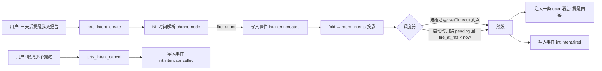

# V1-14 前瞻记忆：立项调研（2026-11-03）

**结论先行**：V1-14 可以立项，但它不是「记忆模块的延伸」，而是一个**新子系统**——
核心工作量在三处：自然语言时间解析（记忆模块明确划走了这块）、进程生命周期之外的
调度语义（PRTS 是会话式 CLI，不是常驻服务）、事件条件触发（需要挂到对话事件上）。
粗估 3 个可独立验收的波次，不含真实使用验收。

---

## 一、验收原文与拆解

> V1-14 前瞻记忆：10 条带时间或事件条件的意图，到期后全部按时触发；重启不丢失；取消的意图不再触发。

三条判据对应三个子系统：

| 判据 | 子系统 | 现状 |
|---|---|---|
| 「带时间或事件条件的意图」 | 意图解析（NL 时间 + 事件条件） | **零**；记忆模块的 `parseTime` 明确不做 NL |
| 「到期后全部按时触发」 | 调度与触发 | 只有空闲调度器，不是定时唤醒 |
| 「重启不丢失」「取消后不再触发」 | 持久化与状态机 | 有现成模式（事件链 + 投影） |

---

## 二、现有基建盘点

| 基建 | 位置 | 可复用度 |
|---|---|---|
| 事件链 + 投影（append-only + fold） | `src/ledger/`、`src/memory/fold.ts` | **直接复用**：意图是事件，状态是投影 |
| 模型侧工具注册模式 | `src/runtime/task-tools.ts` | **直接复用**：`prts_intent_*` 可照抄 |
| 空闲调度器（setTimeout + abort + queued） | `src/runtime/memory-scheduler.ts` | **模式可借**，但它只在进程活着时有效 |
| 时间解析 | `src/memory/time.ts` | **不可复用**：注释明写「不做自然语言时间解析，那是另一个模块」 |
| DSH `ctx.jobs` | `dsh-agent` 运行时 | 待核实：它是作业管理，不是定时器 |
| `supervisor`（进程外守护） | `src/supervisor/` | 可选：若要「进程不在也触发」才需要 |

**关键缺口**：`time.ts` 支持的格式全是实测过的固定形态（`"1:56 pm on 8 May, 2023"`、
`"2023/04/10 (Mon) 17:50"`），不做"明天下午三点""三天后""下周一"这类。

---

## 三、三个关键决策

### 决策 1：时间解析 —— 走「模型解析 + 本地校验」，不用 chrono-node

**实测推翻了 chrono-node 方案**（10 条中文表达，基准时刻 2026-11-03 10:00 +08:00）：

```
✅ 明天下午三点 → 11-04 15:00      ✅ 今晚八点 → 11-03 20:00
✅ 下周一      → 11-09 12:00      ✅ 2026年12月1日 → 12-01 12:00
✅ 三天后      → 11-06 12:00      ✅ 后天上午十点半 → 11-05 10:30
❌ 月底前      （未解析）
❌ 下个月15号  （未解析）
❌ 一小时以后  （未解析）
⚠️ 两周后的周五 → 11-06 12:00（解成本周五，语义错）
```

**7/10 且带语义错**——不能作为解析层。

**改选：模型解析 + 本地校验。** 意图创建本来就是模型发起的工具调用，让它在参数里直接给
绝对时间：

```
prts_intent_create({ fire_at_iso: "2026-11-06T15:00:00+08:00", action: "...", condition_raw: "三天后" })
```

- 模型的职责：把 `condition_raw`（用户原话片段）转成 `fire_at_iso`。当前时间由工具描述
  明确给出，避免模型自己猜"今天几号"。
- 本地职责：`new Date(fire_at_iso)` 校验合法性 + 拒绝过近/过远的取值（如 < 5 分钟后、
  > 2 年后）——模型的时间算术不可全信，这是硬闸门。
- `condition_raw` 原样落库，触发时回显「你原话说的是『三天后』」，让用户能发现解析偏差。

**理由**：中文相对时间表达是开放集合，自研规则覆盖有限（"月底前""一小时以后"已经漏了）；
而工具调用路径上模型本来就要理解这句话，让它顺手输出 ISO 成本最低。
**代价**：模型可能算错时间——所以必须有本地校验 + 原话回显，错的时候用户能看出来。

chrono-node 仍可保留为**英文/ISO 兜底**（英文覆盖好），但不作为中文主路径。

按项目规则，确定采用后要把选型结论归档到参考库（固定 commit，不 import 归档目录）。


### 决策 2：调度 —— 进程内定时 + 启动补触发，明确「按时」的语义边界

PRTS 是会话式 CLI（`chat-main.ts`），不是常驻服务。因此「到期后按时触发」有三种可能语义：

| 方案 | 语义 | 代价 |
|---|---|---|
| A. 进程内定时器 | 只有进程活着时才"按时"；进程不在则错过 | 最简单，但验收会失败（"全部按时"做不到） |
| B. **进程内定时 + 启动补触发** | 到期时若进程在 → 准点；不在 → 下次启动时补触发并标注延迟 | 中等，语义诚实 |
| C. OS 级定时（Windows 任务计划） | 真正按时，即使 PRTS 没开 | 引入系统依赖、要处理"触发后往哪送" |

**已定案：B**（2026-11-03 用户拍板）。「按时」的口径因此确定为：到期时进程在 → 准点触发；
进程不在 → 下次启动补触发，且触发文案**必须如实告知**「这条提醒原定 X 时间，现在补发」。
C（OS 级定时）保留为后续可选升级，不作为首版要求。

验收时要按这个口径判定，不能拿「严格按时」的标准量 B——那是 C 的语义。

### 决策 3：存储 —— 事件链 + 投影，与记忆模块同构

```
mem_intents（投影表）
  intent_id, scope, kind('time'|'event'), condition_raw, fire_at_ms,
  status('pending'|'fired'|'cancelled'|'missed'), created_at_ms,
  fired_at_ms, cancelled_at_ms, source_turn_id
```

意图的创建/触发/取消都写成事件，投影由 `applyMemoryEvent` 同款 fold 维护。
好处：重启不丢失是**免费**的（事件已在链上），「取消后不再触发」也只是一个状态判定。

---

## 四、设计草案



模型侧工具（照 `prts_task_*` 的形状）：

| 工具 | 语义 | 是否需所有者确认 |
|---|---|---|
| `prts_intent_create` | 建意图（自然语言条件 + 动作） | 否（创建无副作用） |
| `prts_intent_list` | 列 pending 意图 | 否 |
| `prts_intent_cancel` | 取消 | **是**（与 `prts_task_*` 的纪律一致：破坏性动作要 owner） |

触发动作：向当前会话追加一条 `user` 消息（与记忆注入同一通道），文案必须自报
「这是你 X 时间设置的提醒」。

---

## 五、未决问题（实现前必须拍板）

1. **「按时」的语义**（决策 2 的 A/B/C）——直接影响能否通过验收。
2. **事件条件的形态**：「当我下次提到相机时提醒我」这类，需要挂到检索事件还是对话事件？
   V1-14 原文说「时间或事件条件」，但没给事件的例子。建议第一版只做时间条件，
   事件条件单独立项（它是另一套匹配语义）。
3. **触发后如果用户不在**：补发的消息留在会话里，还是等下次对话开头再注入？
4. **意图数量上限与过期**：10 条验收之外的长期积压如何处理（自动过期？）。

---

## 六、工作量与波次建议

| 波次 | 内容 | 可验性 |
|---|---|---|
| W1 | 时间解析适配（chrono-node + 中文对照 20 条）+ 意图表与事件投影 | 单测可验：20 条中文表达解析正确率 |
| W2 | 模型工具 + 取消（含 owner 确认）+ 列表 | 单测可验：创建/取消/状态流转 |
| W3 | 调度器（进程内 + 启动补触发）+ 触发注入 | 集成测试可验：模拟时间推进、重启补发 |
| W4 | 验收：10 条意图全生命周期 | **需要真实使用**（同 V1-06 的处境） |

W1–W3 是纯代码，W4 依赖真实使用——和记忆模块一样，最后一段只能靠用出来。

---

## 七、外部参考（待归档）

| 来源 | 用途 | 状态 |
|---|---|---|
| [chrono-node 2.10.1](https://www.npmjs.com/package/chrono-node) | NL 时间解析 | 待实测中文覆盖 |
| [PM-Bench (arXiv 2607.12385)](https://arxiv.org/abs/2607.12385) | 前瞻记忆的对标基准（Virtual Week 范式） | 待读全文 |
| proactive_memory_agent | sidecar 记忆 agent 的提醒注入形态 | 待评估 |

按 `AGENTS.md`：确定采用后归档到 `C:\Users\Administrator\Desktop\参考库\`，记录固定 commit，
归档目录只读、不当依赖 import。
