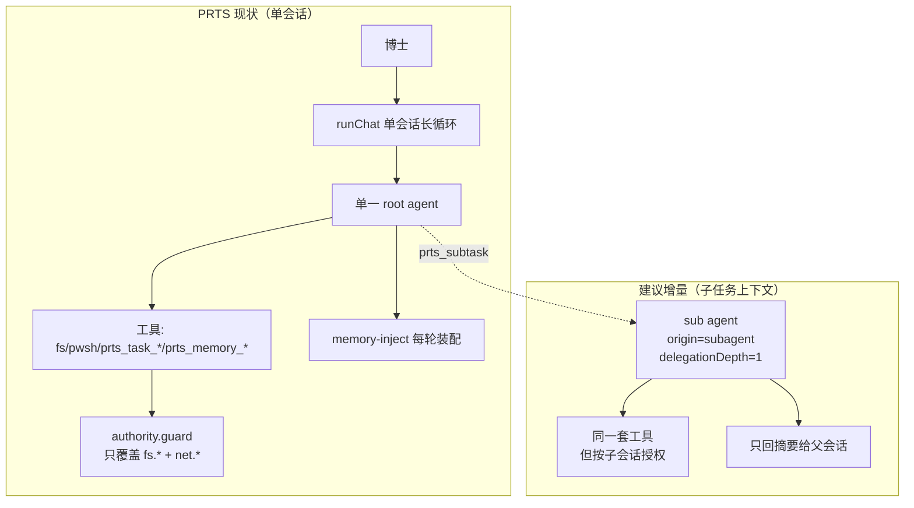

# Super-agent 架构与 PRTS 的融合方案

2026-11-03。依据：`docs/design-net-policy.md` §五（仓内对 Super-agent 五模块的转述）、
一手来源《Super-agent 设计探索：迈向更自主的 Agent 系统》（DeepSeek Harness 团队，2026-10-31）、
`docs/reference/PRTS-ARCHITECTURE-REQUIREMENTS-2026-10-29.md` §4/§5/§10、
以及本文件第一节的**实测探针**（不是推断）。

---

## 一、先摆事实：机制层已经通了，缺的不是架构

`.rivet/scratch/probe-subagent-session.mjs` 在真实 PRTS 运行时（`startRuntime` + scripted LLM）上验了四条：

| 判定 | 结果 |
|---|---|
| A. `agents.create` 带 `meta.origin:'subagent'` 不抛错 | ✅ |
| B. root 与 sub 两个 agent 同时 idle 并存 | ✅ |
| C. `session.v4.jsonl` header 真记住血缘 | ✅ `parentSession` / `origin:"subagent"` / `delegationDepth:1` / `agentPreset:"worker"` |
| D. dispose 子会话后父会话仍 idle | ✅ |
| 附加 | 子会话跑完一个 turn 回到 idle，315 ms |

结论：**Router/Worker 的机制本钱 DSH 已经付过了**。`ctx.get('agents').create()` 是
`src/cli/chat.ts:492` 的生产路径（不是测试专用），`CreateAgentOptions.meta`
（`dsh-agent/lib/types/index.d.ts:48-71`）本来就为子会话预留了 origin / 血缘 / 递归预算 / 配置档。

同一批实测还捞到一条负面事实：**`delegationDepth` 没有框架级上限**。
`dsh-session/lib/index.js:1054` 只校验它是「非负安全整数」，没有任何「超过 N 层拒绝」的逻辑。
谁想要递归预算，谁自己写。

---

## 二、五模块对账：三条已达成，两条半成品

| Super-agent 模块 | PRTS 现状 | 判定 |
|---|---|---|
| 2 事件驱动（Fast Path 确定性筛 + Slow Path 模型研判） | `classify` + `Authority` 分工；V1-14 意图库已有时间触发 | **已达成的部分**：时间触发。缺外部事件源（IM / 邮件 / CI） |
| 3 面向人的交互（异步 start/stop、Inline & Spill） | `src/spill`（512 行，可回读卸载）、`ctx.jobs`、`StopController` | **半成品**：卸载与停止有；「后台任务不阻塞前台对话」没有——`runChat` 是单会话长循环 |
| 4 计算/状态/环境分离 | 事件链 = 状态入库；`src/sandbox` = 环境留在本地；LLM 适配器可换 = BYOM | **已达成**，无动作 |
| 5 外部 Watchdog | `supervisor`（进程外 Job + 崩溃重启）+ `StopController`（分级停止） | **半成品**：只答「进程活着吗」，不答「是否原地打转或偏离目标」 |
| 1 双层 Router/Worker | 机制通（见第一节），**零使用**：`agent-loop.agents: []`，无任何工具包装 | **未建设**，且现在不该建（见第四节） |

---

## 三、现在要做的三件事（按 ROI 排序）

### ① 工具循环检测（模块 5 缺的那一半）

`supervisor` 答的是「进程活着吗」。Super-agent 的 Control Loop 答的是「这活是不是在原地打转」。
PRTS 有现成的挂载点：`tools/result` 是已验的 emit 事件（`start.ts:340` 的回合记账就挂在上面）。

规则（确定性，不经模型）：同一 `toolName` + 参数规范化后哈希，连续 N 次（建议 5）相同 →
写一条 `agent/observe` 样本 + 调 `StopController` 把本回合标为「疑似循环」。

**计数器必须按 sessionId 分桶**，否则并发子会话的同参重试会被并进同一个计数（议事会提出的风险，成立）。
好消息是载荷里就有归属：`tools/result` 的 `execution` 带 `agent.session.id`（`start.ts:420-425` 的
`endStep` 已在用它）——所以这是实现纪律，不是能力缺口。议事会判断「检测点缺会话归属」与代码不符，
此处按实测更正。

为什么先做它：20-40 行、零架构变更、直接防「模型把预算烧在重复调用上」这类真实损耗。
而 handoff（`docs/HANDOFF-20261103-session.md` 三-3）已经把它列为未做项。

### ② 子任务上下文 `prts_subtask`（模块 1 的最小可用切片）

不做常驻 Router，只做**一次性的子会话**：父会话调 `prts_subtask(task, cwd?)` →
`agents.create({meta:{parentSession, origin:'subagent', delegationDepth:父+1}})` →
子会话跑完 → 只把**摘要**回给父会话 → dispose。

价值：长任务（读 10 个文件汇总、跑一轮基准）不把中间过程塞进主会话窗口。
这正是架构需求 §5.2 设计图里写的「模型 ——（需要时）……开子任务上下文」。

必须先解决的三道硬约束（不做就会变成安全洞或脏数据）：

1. **权限会被静默继承——这是已经发生的事实，不是待防的风险**（2026-11-03 议事会指出，已核）。
   `validGrants()` = `audit.listGrants()` 过滤撤销/过期，`map` 时把 `subject` 丢掉（`authority.ts:105-111`）；
   `evalCap` 只按 `g.capability` 匹配，**不看 `subject`、不看 `sessionId`**（`authority.ts:157/182/188`）。
   后果：父会话拿到的持久 grant 对子会话直接生效；工作区内的 `fs.write` 更是走 `via:'policy'` 无条件放行
   （`authority.ts:150-155`），连 grant 都不需要。`once` 按 `callId` 消费（`:206`），这部分确实不继承——
   但它只是三道门里最小的一道。
   **判据**：把这层当安全边界前，必须新增能力（给子会话一个收窄的 `workspaceRoots` / 只读根集）；
   单改 `validGrants` 加 subject 过滤不够——`via:'policy'` 那条路绕开了 grant。
   本条**未实测**。落地前先写三条负向测试：持久 grant 不使子会话 allow via grant；父会话 once
   不被子会话以另一 callId 消费；子会话在工作区的 `fs.write` 为 deny 而非 `via policy`。
2. **账本不自动继承**。`taskForSession(sessionId)` 是单绑（`task-tools.ts` 的归属校验），
   子会话调 `prts_task_*` 会因无绑定被拒——**这是唯一真正的强制点**。
   注意：工具在 boot 期全局注册，「不向子会话暴露账本工具」在现有架构下做不到，别把它写成方案；
   真正的兜底就是绑定校验本身（`taskForSession` 返回 undefined 即拒）。另一条路是引入「子会话继承
   父任务」的新绑定，要动 `ledger` 且不能破坏「模型永不绑定」不变量——不推荐。
3. **记忆污染的正确形状是「派生轮次不进生产召回」，不是「子会话的 turn 读不到」**（议事会修正，方向已核）。
   PRTS 的记忆本就是跨会话共享的所有者长期记忆，按 session 一刀切会把跨会话召回这个主功能打穿。
   `mem_sessions` 已有 `session_id / scope / origin / body / turn_count`（`schema.ts:152-157`），
   先核 `scope` 能否直接承载「派生轮次」语义再谈新维度；`origin` 的 CHECK 是 `'live' | 'benchmark'`，
   语义是数据来源，**不得**挪用来标 subagent。

### ③ 意图触发从「时间」扩到「任务事件」

V1-14 的触发只有时间闸门。Super-agent 模块 2 的第二级过滤（语义研判）PRTS 用不上——
博士本人就是事件源，不需要模型去筛群聊。低成本扩展：任务 `blocked` 超过 N 小时、
或 `claimDone` 后无人验收超过 N 小时，主动提醒一次。复用 `intent-trigger.ts` 的既有管道。

---

## 四、现在不做的：常驻 Router

**前提已更正（博士 2026-11-03）**：真实使用要等到 PRTS 整体完工之后。
所以「等真实使用暴露并发压力再上 Router」不能作为开发期的判据——那个触发条件
被推迟到了验收阶段。结论不变，理由换成三条不依赖真实使用的：

1. **产品形态里没有这个瓶颈**。Super-agent 要解决的是「一个人同时盯不住 3-5 个以上会话」。
   PRTS 的入口是终端 + 所有者命令（`/task`、`/intent`、`/memory`），一次只有一条对话流，
   不存在「手动在会话间切换、还要记住每个会话里有什么」的负担。
   模块 1 的火力对准的是 IM/GitHub 那种多线程事件流，PRTS 没有那个形状。
2. ~~位置不对（§10 依赖顺序）~~ ——**这条已撤回**（议事会指出，核对属实）：§10 把 Router 与本方案
   自己推荐的三件增量都归入「第一版实现」，用同一把尺子会连后者一起否决。
   另：上一条（产品形态）是**不可测的产品断言，属判断不是证据**；若产品变成多入口并发，它第一个失效。
3. **无真实负载时，编排层的正确性无法被验证**。并发时序、跨会话上下文同步、子会话回收，
   是最难用单测覆盖的一类；没有真实负载，做完也只能自证。
   在这一点上，「先做能被确定性验证的部分」不是保守，是唯一能交付证据的路径。

**什么情况下重新评估**：不是「等真实使用」，而是当 W2 的 `prts_subtask` 在离线基准上
被证明不够用——即出现「单次任务必须并发多个子任务才满足延迟或上下文预算」的实测场景。
那是可测的，不需要等博士上手。

## 四之二、由此暴露的一个循环依赖（需要博士定夺）

「整体完工后才真实使用」与验收清单存在循环：

- V1-01…V1-13 是「完工」的验收，但 V1-06（记忆）、V1-08（上下文）、V1-13（连续使用 7 天）
  都必须**真实使用**才能判定；
- 若真实使用在完工之后，那么「完工」只能指**工程完工**（代码 + 测试 + 离线基准），
  而 V1 验收是完工之后的独立阶段。

建议把两件事分开写进计划，别用同一个「完工」：

- **R1 工程完工**：`npm test` 全绿、`tsc` 退出 0、离线基准达标（记忆 @5 现状 38.1%，
  LongMemEval 基线已建）。这些今天就能判定，不需要博士上手。
- **R2 验收完工**：V1-01…V1-13，需要真实使用，R1 之后开始。

**一条必须保留的例外**：R1 期间也要定期做「冒烟启动」，不是功能验收，是防腐烂。
理由：如果连续数周不真的启动一次，完工时最可能失守的不是功能，而是启动链路本身——
依赖版本漂移、`PRTS_NET_ALLOW` 之外的 ACL 授权失效、key 过期、沙箱后端在系统更新后行为变化。
这些都不在单测覆盖范围内，单元测试用的是临时目录和 scripted LLM。
最小动作：每周（或每次跨模块改动后）跑一次
`PRTS_EMBED=1 PRTS_RERANK=1 node src/cli/chat-main.ts`，发一句「你好」，确认能起来、能回、
warm 日志符合预期。五分钟，不算使用，算体检。

---

## 五、否决清单（别重走）

| 方案 | 否决理由 |
|---|---|
| 用 `delegationDepth` 当递归预算 | 框架只管格式校验（实测 `dsh-session/lib/index.js:1054`），没有上限逻辑。要预算自己写 |
| 把子会话的授权从父会话继承 | 破坏「授权判定按 sessionId」这条安全不变量。宁可让子会话重新问人 |
| 复用 `memory.origin` 标 subagent | 该列的 CHECK 约束是 `'live' \| 'benchmark'`，语义是数据来源不是会话来源。改语义会污染基准评测的区分 |
| 直接把 Router 做成常驻服务 | 见第四节：无并发压力、成本常驻、违背阶段顺序 |
| 照搬模块 2 的「语义层 Slow Path 研判外部事件」 | PRTS 的事件源是博士本人，不是群聊/邮件流。没有要筛的东西 |

---

## 六、实施波次

| 波 | 内容 | 验证 |
|---|---|---|
| W1 | 工具循环检测（`tools/result` → 连续 N 次同工具同参 → 标记 + StopController） | 单测：连续 5 次相同调用被标记；4 次不标记；参数不同不标记。真机：跑一个会重复调用的假场景 |
| W2 | `prts_subtask` 工具 + 子会话记忆隔离 | 单测：子会话 turn 不进主召回；子会话无账本工具；父会话只收到摘要。真机：一次读 10 文件汇总 |
| W3 | 任务事件触发的主动提醒 | 单测：blocked 超阈值触发一次、不重复触发、重启不丢 |
| — | 常驻 Router | **不排期**，等第四节的触发条件 |

## 七、预测的失败模式（先写下来，复查时对照）

1. `prts_subtask` 的子会话如果沿用父会话的 `scriptedLlm` 式共享 cursor，会在并发时错位 ——
   测试必须给子会话独立脚本。
2. 循环检测在「合理重试」场景会误报（模型重试同一命令因为它第一次超时）。
   判据要含「参数完全相同」且「无新增证据」，否则会打断正常重试。
3. 子会话 dispose 时若父会话正在等它，`waitIdle` 的 120s 上限会先到 —— 需要子会话有独立超时。

---

## 八、议事会研判记录（2026-11-03）

四席：tianquan（架构称量）、tianji（前提质疑）、tianfu（守边）、yaoguang（验证纪律），两轮。

### 采纳并在本文件内改正的

| 指控 | 核实结果 | 本文件处置 |
|---|---|---|
| 持久 grant 全局生效，子会话自动继承（三席一致） | **成立**。`validGrants()` 丢掉 `subject`（`authority.ts:105-111`），`evalCap` 只按 capability 匹配 | 第三节 ① 整条重写：这是既成事实，不是待防风险 |
| 账单/记忆两条方向需修正 | 成立 | ② 改为「绑定校验是唯一强制点」；③ 改为「派生轮次不进生产召回」 |
| 理由②（§10 位置论）逻辑不成立，同一把尺子会否决三件增量 | 成立 | 第四节第 2 条撤回，标注原因 |
| A5 反向验证只覆盖 D1，D4 不可测 | 成立 | 见下方「未修的欠账」 |
| 探针放在 `.rivet/scratch`，不可重跑 | 成立 | 未修，记为欠账 |

### 不采纳的

议事会称「A4 检测点缺会话归属，会把并发子会话的同参重试并进同一计数器」——**风险成立，事实不成立**：
`tools/result` 的 `execution` 带 `agent.session.id`（`start.ts:420-425` 的 `endStep` 已在用）。
已改为「计数器必须按 sessionId 分桶」的实现纪律，并注明此处与议事会判断不符。

### 欠账状态（2026-11-03 晚更新）

**已还**：

1. **A3 的三条负向测试已写**：`test/acceptance/subagent-authority.test.ts`，5 条全绿。
   性质是**特性化测试**——①②③ 断言的是现状（继承发生 / 无 once 为 ask / 工作区内 via:'policy'），
   绿不表示安全，只表示「缺陷与本文档描述一致」。W2 加收窄能力后 ①③ 必须翻转为 deny 断言。
   其中 ② 已诚实改名：它只证明「无 once 默认 ask」，**once 跨会话未被实测**，
   那句推断来自读码（`authority.ts:206` 按 callId 消费），已在注释里标明是推断不是实测。
3. **探针已固化**：`test/acceptance/subagent-session.test.ts`，四条判定（创建 / 并存 / 血缘落盘 /
   独立回收）进 CI，932 ms 跑完。「机制可用」现在是可重复验证的结论。

**仍欠**：

2. **A5 的断言强度不足**：D1（记忆召回）做过反向验证；D2（账本）、D3（意图）没有证伪动作；
   D4（不降级只读）实际不可测——`mode` 是测试入参，且第 2/4/7 天无写操作。
   「7 次 2.09s 全绿」是近空库上的数字，不能外推真实体量。
4. **崩溃/强杀后的 WAL 恢复**未覆盖——soak 走的是 `dispose()` 正常关闭路径。
