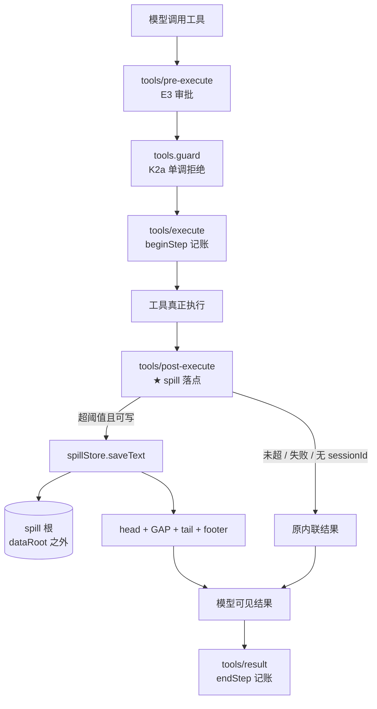

# PRTS 工具结果卸载（spill）设计

状态：v2，经议事会四席复评后修订（2026-11-01）。对应架构需求 §5.3「工具结果卸载」条。

v1 有一处自相矛盾的硬伤，四席一致指出，已改：根位置从 `<dataRoot>/spill/` 移到 dataRoot 之外的独立根。详见 §八「议事会意见与处置」。

## 一、要解决什么

§5.3 原文：「大结果存入对象存储，工作区只放引用、摘要与关键片段，需要时分页读取。」

PRTS 现在没有这一层。模型 shell 的输出、`read` 读到的大文件，整段进上下文。长任务里上下文被一次性大结果挤满，而这类内容九成不会再被看第二眼。

验收对应 V1-16（装配 P95 ≤ 1s，不含模型调用）与 V1-08（长对话后仍答得出开头确认的 5 个约束）。

## 二、参考实现：DSH 的 spill

| 件 | 职责 | 不做什么 |
|---|---|---|
| `dsh-spill` | 一方法抽象服务 `saveText(input) → SpillRef` | 不管保留策略、不替换结果、不提供检索 |
| `dsh-spill-local` | 本地后端：私有根 + 会话子目录 + 独占写 | 不决定何时 spill |
| `dsh-spill-policy` | 消费方：超阈值换成 head/tail + 地址 | 不碰存储实现 |

值得照抄的三个决定：

1. **`saveText` 是唯一操作**，`locator` 与 `retrievalHint` 分开。消费方不解析 `locator`，只把 `retrievalHint` 交给模型。
2. **`suggestedName` 只是命名提示**。`encodeSegment` 是注入式编码：非 `[A-Za-z0-9._-]` 的 UTF-16 码元一律转义成 `~XXXX`，`~` 自身也转义，`.` / `..` 专门处理。`../`、绝对路径、NUL 全部中和，且不同输入不碰撞。
3. **`open(path, 'wx', 0o600)`**：`wx` 独占创建，预置符号链接无法重定向写入。

policy 侧的关键逻辑：

- 挂 `tools/post-execute`，只在 `decision.kind === 'accept'` 且不带 `value` 时处理
- **`exec.name === 'read'` 跳过**——否则读 spill 文件的结果又被 spill，无限套娃
- 先扣 GAP 与最坏 notice 的预算，剩下的才给 head/tail
- 图片整块保留不切，放不下就整块丢弃并计入 omitted
- 切文本时**不切在 UTF-16 代理对中间**，用二分找最长可容纳前缀/后缀
- **任何异常都 catch → warn → 保留原内联结果**：卸载是优化，不能把成功的工具调用变成失败

## 三、PRTS 现状（实测）

| 事实 | 证据 |
|---|---|
| `dsh-tools@0.2.1-rc.2` **有** `tools/post-execute`（waterfall） | `node_modules/@deepseek-ai/dsh-tools/lib/types/index.d.ts:70` |
| `@deepseek-ai/dsh-token-meter` 在依赖里，可用 `estimateContent` | `package.json` |
| **没有** `@deepseek-ai/dsh-spill`，存储自建 | 同上 |
| `protectedRoots: [o.dataRoot]`、`workspaceRoots: [o.workspace]` | `src/runtime/start.ts:136-137` |
| `classify` 只产生 `fs.read`（read/read_image）与 `fs.write`（write/edit），**没有 `fs.delete` 来源** | `src/authority/classify.ts:23-28` |
| `fs.read` 对非 protectedRoots 路径**无条件 allow** | `src/authority/authority.ts` 的 `case 'fs.read'` |
| `pwsh` 归 `exec:shell`，被 K2a 过滤掉，归 K2b（未实现） | `src/runtime/start.ts:159-166` 及注释 |

## 四、设计



### 4.1 接口

```ts
// src/spill/types.ts
export interface SpillStore {
  saveText(input: SpillSaveInput): Promise<SpillRef>
}
export interface SpillSaveInput {
  sessionId: string      // 必填非空；空则调用方不 spill
  toolName: string
  callId: string
  suggestedName: string
  content: string
}
export interface SpillRef {
  locator: string        // 消费方不解析；当前实现是绝对路径
  bytes: number
  retrievalHint: string  // 交给模型的说明，含路径
}
```

`SpillStore` 是接口而非具体类——议事会要求的注入点：测试用会抛错的实现跑 T2，不必伪造文件系统权限。

### 4.2 存储位置（v2 变更）

**根：`<dataRoot 的父目录>/prts-spill/`，可用 `PRTS_SPILL_ROOT` 覆盖。**

必须满足三条，启动自检断言（不满足则拒绝启用 spill，不拒绝启动）：

1. **不在 `protectedRoots` 内**——否则 `fs.read` 先被判 deny，回读不了，卸载等于删除
2. **不在 `workspaceRoots` 内**——否则模型可改可删，且污染工作区的 `ls`
3. **与两者都不相交**——按 realpath 归一后比较（`authority.ts` 里 `workspaceRoots`/`protectedRoots` 都过了 `realpathBestEffort`，`spillRoots` 必须同源归一，否则大小写/短路径/符号链接会让相交判断失效）

布局：`<spillRoot>/session-<sha256(sessionId).slice(0,16)>/<12 字节随机 hex>-<encodeSegment(suggestedName)>`。

v1 用 12 个 hex 字符（48 bit），议事会指出碰撞后果是跨会话读到彼此的 spill 文件；改为 16 hex（64 bit）。

### 4.3 落点

`ctx.on('tools/post-execute', ...)`，与现有 `pre-execute`/`execute` 同一挂法。`next()` 必须调用，否则 cordis waterfall 会打断整条链。

过滤条件，顺序即语义：

1. `decision.kind !== 'accept'`、`Object.hasOwn(decision, 'value')`、或 **`result.isError === true`** → 跳过（错误信息截断会丢诊断价值。DSH 没做这条，PRTS 加：v1 以为 `kind !== 'accept'` 能排除它，实际错误结果仍是 `accept`）
2. `exec.name === 'read'` → 跳过（防套娃）
3. `sessionId` 缺失或空 → 跳过，stderr 一条（按调用方去重）。PRTS 有 sessionId 空串历史（`docs/cross-module-contract.md` §1），此处不 invent 共享目录
4. estimated tokens ≤ 阈值 → 跳过
5. 该会话已超体积上限 → 跳过（见 4.5）

阈值：`PRTS_SPILL_MAX_INLINE_TOKENS`，默认 **8000**。议事会指出「缺省不启用」会让交付后行为零变化、无法验证也无法回归，故给初始值；实测后按 V1-16 数据再定。测试用例不依赖环境变量默认态，显式传入。

### 4.4 失败语义

| 情况 | 行为 |
|---|---|
| `saveText` 抛错（权限/ENOSPC/根不可用） | catch → stderr → 保留原内联结果 |
| `sessionId` 空 | 不 spill，stderr 一条 |
| 估算抛错 | 同上 |
| notice 本身超阈值 | 同上（不为塞通知把内容全丢） |
| 超体积上限 | 不 spill，stderr 一条（**不删既有文件**） |

不变量：**spill 失败永远不改变工具调用的成功/失败状态**。

### 4.5 体积上界

议事会指出 v1 的「不做保留期」+「宿主不提供删除 API」叠加 = dataRoot 内出现只增不减的目录。v2 的处理：

- 单会话上限：`PRTS_SPILL_SESSION_MAX_BYTES`（默认 64 MiB）与 `PRTS_SPILL_SESSION_MAX_FILES`（默认 200）
- 超限时**降级为不 spill**，不删文件
- 全局清理另立项；在设计里明确「无清理期间的单会话上界是 64 MiB × 会话数」这一可接受度

## 五、安全不变量

### 5.1 三类根的判定

`AuthorityConfig` 增加 `spillRoots: string[]`，与另两类同源 realpath 归一。判定顺序 **protectedRoots > spillRoots > workspaceRoots**：

| 能力 | 在 spillRoots 内 |
|---|---|
| `fs.read` | allow（spill 的唯一目的） |
| `fs.write` | **deny** |
| `fs.delete` | **deny**（见 5.3：当前无可达路径） |
| `net` / `exec` / `system` / `tool` | 不受影响 |

顺序在 v2 里不再承担「同时保护与放行」的矛盾功能——因为 spill 根已移出 protectedRoots，两类根不相交，顺序只作防御。

### 5.2 宿主特权与它的边界

写 spill 文件的是宿主（post-execute 钩子内），不是模型工具调用，因此不过 `tools.guard`。这是有意为之（否则每次 spill 都要问人一次），边界：

- 只写 `spillRoots` 内，路径由「根 + 会话哈希 + 随机名」拼出，**不接受模型提供的路径成分**
- 不覆盖（`wx`）、不跟随符号链接
- 宿主不提供删除 API
- **父目录必须已存在且不是 junction/symlink**——议事会指出 v1 漏了父目录穿越；实现时 `mkdir` 后 `lstat` 校验父链

### 5.3 两条必须写入文档的诚实边界

**一、Windows 上没有 POSIX mode 位。** `0700` / `0600` 在 win32 上不产生访问控制；把它们写成安全属性会误导读者。PRTS 跑在 Windows 上，真实边界来自：根位置（不在 workspace）+ 后续 K2b 的进程级沙箱。仓库里已有用 `icacls` 做真授权的先例（`src/sandbox/appcontainer.ts`），若要让 spill 根在 Windows 上真正私有，须走同一条路——**不在本设计范围，列为遗留项**。

**二、`fs.write` / `fs.delete` 的 deny 只覆盖工具面，不覆盖 shell。** `pwsh` 归 `exec:shell`，被 K2a 过滤（`start.ts:165`），模型可以用 `pwsh` 直接写 spill 文件。所以 spill 的防篡改当前**只对 `write`/`edit` 工具成立**，对 shell 敞开。这不是本设计能修的，属 K2b。

**三、`classify` 当前不产生 `fs.delete`。** `fs.read` 来自 read/read_image，`fs.write` 来自 write/edit，其余落 `exec`/`tool`。因此 spillRoots 的 delete 规则**没有可达调用路径**，测试也无法覆盖——它是为未来工具预留的规则，文档里必须标注，不能算作已验证的保护。

## 六、验证

落码前先写测试（RED → GREEN）。前四条是功能，后两条是接线。

| # | 用例 | 期望 |
|---|---|---|
| T1 | 结果超阈值 + 存储可用 | 返回含 head、`[...]`、tail、footer；footer 里的路径真实存在且内容**逐字等于**原文（不是长度相等） |
| T1b | emoji 恰好跨切点 | 结果不含孤立代理项，Buffer 往返后仍是合法字符串 |
| T1c | 单个 text 块就超预算 | 走二分前缀/后缀路径，仍产出合法 head/tail |
| T2 | 注入会抛错的 `SpillStore` | 返回**原始未截断内容**，`isError` 不变。不用伪造文件权限——Windows 无 mode 位，「根不可写」造不出来 |
| T3 | `read` 工具结果超阈值 | 不替换 |
| T4 | `sessionId` 为空 | 不替换、不写文件、stderr 恰好一条 |
| T4b | 超会话体积上限 | 不替换、不新增文件、既有文件不变 |
| T5 | 模型 `read` spill 根内文件（真实 Authority） | allow（**功能验证**，不是反证：`fs.read` 对非 protected 路径本来就 allow） |
| T6 | 模型 `write` spill 根内文件（真实 Authority） | **deny，且 `reason` 匹配 spill 专属理由串**。只断 `kind === 'deny'` 不够——protectedRoots 也能造出 deny，理由串才能区分是哪条规则在做事 |

**反证（瑶光式）：** 删掉 `spillRoots` 判定后重跑 T6。spill 根既不在 protectedRoots 也不在 workspaceRoots，删掉后 `fs.write` 会落进 grant 检查并返回 `ask`（`authority.ts` 的 `case 'fs.write'` 兜底），断言 `deny` 失败 → **T6 变红**。

T5 不是反证：删掉 spillRoots 后 read 仍然 allow，不会变红。v1 把 T5 当反证是错的。

## 七、不做的

- **不做多后端抽象**。PRTS 只有本地盘，DSH 的 seam 是给远程后端用的。（但 v1 那句「locator 不透明」要收回：`retrievalHint` 把绝对路径直接交给模型，只有「消费方不解析」这层含义。）
- **不做 per-session 保留期与清理**。只做体积上界（4.5），清理另立项。
- **不卸载图片**。PRTS 当前没有图片工具结果路径。

## 七之二、与上游工具自身截断的关系（落码实测发现）

接线级测试（`test/spill/live-wiring.test.ts`）跑出的事实：让 pwsh 输出 40000 字符，`tools/post-execute` 收到的只有 **16244 字符**。查证来源——`@deepseek-ai/dsh-tool-pwsh-persistent` 自带 `maxOutputChars` 上限，`maybeTruncate` 截到 16000 后追加一段截断提示（`lib/index.js:76-78`）。

这改变了 spill 对 pwsh 的价值判断：

- **pwsh 的截断是纯丢失**：模型只看到前 16000 字符，没有回读途径，超出的部分对本次会话永久不可得。
- **spill 的卸载是可回读**：存全文，给路径，模型需要时能 `read` 回来。
- 两者叠加时，spill 只能卸载 pwsh 已经丢掉一部分之后的内容——**超长的部分在到达 spill 之前就没了**。

正确的处理不是让两者竞争，而是**把上游上限调高、让 spill 接管卸载**（`maxOutputChars` 是 config 参数）。但调高会付出内存与延迟代价，且 PRTS 当前没有实测数据，故不在本设计范围内改动，记为待办：

- 待办：测 `maxOutputChars` 调高到多少时，pwsh 的峰值内存与延迟仍在可接受范围；有了数据再把上游上限与 spill 阈值一起定。

同理要注意 `read`：它被本设计排除在卸载之外（防套娃），所以「读超大文件」这条路径当前没有卸载保护。真正该做的是让 `read` 支持分页而不是靠 spill——那条另立。

## 八、议事会意见与处置

四席一致指出 v1 的硬伤：**根在 `<dataRoot>/spill/`，而 `protectedRoots = [dataRoot]`（实测 `start.ts:138`），`fs.read` 分支先判 protectedRoots 就 deny，spillRoots 永远轮不到被查**。我核实成立，v2 移根。

| 意见 | 来源 | 处置 |
|---|---|---|
| 根嵌套在 protectedRoots 内，T5 必红、spillRoots 无判别力 | 四席一致 | **已改**：4.2 移到 dataRoot 之外，并加启动相交自检 |
| T6 是假反证（删规则后仍被 protectedRoots 判 deny） | 天权 / 瑶光 / 天机 | **已改**：移根后 T6 成真反证；并断言 `reason` 可区分 |
| T5 不能当反证 | 瑶光 | **已改**：T5 降级为功能验证 |
| `classify` 无 `fs.delete` 来源，delete 规则不可达 | 天权 / 瑶光 | **已改**：5.3 明写，T6 只覆盖 write |
| Windows 上 0o700/0o600 不生效 | 瑶光 / 天机 | **已改**：5.3 明写，列为遗留项（icacls 路线） |
| T2 在 Windows 上不可构造 | 瑶光 | **已改**：改用注入式 `SpillStore` |
| 47/48 bit 会话哈希碰撞 | 天机 | **已改**：12 hex → 16 hex |
| 「不做保留期」+「无删除 API」= 只增不减 | 天权 / 天机 | **已改**：4.5 加单会话体积上界 |
| 默认关闭导致交付后零变化 | 天机 | **已改**：4.3 给初始默认 8000 |
| 「locator 不透明」表述不实 | 天权 | **已改**：七节收回 |
| 父目录 junction 穿越 | 天府 | **已改**：5.2 加 lstat 校验父链 |
| 账本工具/错误结果被截断 | 天府 | **已改**：4.3 过滤条件 1 显式加 `result.isError === true` 跳过。v1 的 `kind !== 'accept'` 排除不了它——错误结果仍是 `accept`，是 v1 的另一处误判 |
| scope 应砍一半（先只做存储、不动 authority） | 天机 | **部分采纳**：authority 改动压缩到「加一个数组 + 三条判定」，不重构 classify；但不动 authority 则 read/write 无法区分，无法成立 |
