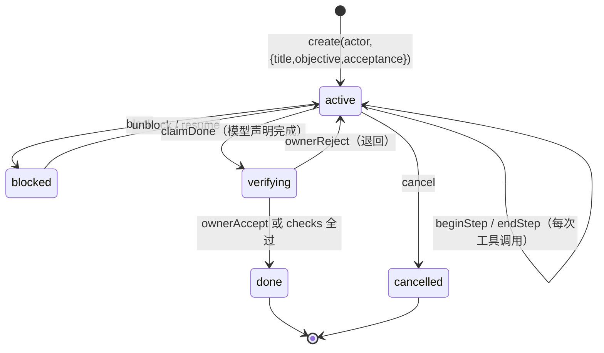

# K1 任务入口设计

状态：设计稿，待实现。2026-10-31。

## 问题

K1 有库无入口。`Ledger.create` 从未被调用——`grep "Ledger.open" src/` 的消费者只有 `supervisor.ts:311`、`main.ts:26/51`、`cli/prts.ts`，没有一处建任务。结果是：agent 跑完一整轮，`ledger_events` 表在真实运行中始终为空。

架构需求 §6 要求「状态只能由执行结果与验收写入」。没有任务，就没有可写入状态的对象。

## 结论

**任务必须显式创建，不能由对话自动派生。**

理由：`create` 要求 `title` / `objective` / `acceptance`（`ledger.ts:391-395`），其中 acceptance 强制二选一——`{kind:'checks'}` 或 `{kind:'owner-confirm'}`。聊天回合给不出这些。若按「每轮对话建一个 task」自动派生，会把闲聊写成任务，而账本是只追加哈希链，写错撤不回。

外部对照：DSH、deer-flow、Codex 都不做任务实体（Codex 的 `RolloutItem` 12 个变体里没有 Task）；天枢与 ruflo 有任务实体，但都在**显式创建**时才存在。PRTS 选了任务账本这条路，就必须补入口。

## 谁能开任务

| 入口 | actor | 说明 |
|---|---|---|
| 博士显式命令 | `{kind:'owner'}` | 终端 `/task <objective>`，可带 acceptance |
| 模型工具调用 | `{kind:'model', sessionId}` | 工具 `prts_task_create`，经 `tools.guard` 判定；模型只能开 `owner-confirm` 或 `checks`，不能自成 owner |
| 自动检测多步执行 | — | **不做**。判据不可靠，会制造噪音任务 |

模型侧 actor 固定为 `{kind:'model', sessionId}`，且不暴露 `verify` / `ownerAccept` / `ownerReject` / `setBudget` / `stopByOwner` / `resumeFromStop` / `chargeUsage` / `recoverOnStartup`（AGENTS.md 的固定 actor 通道契约）。

## 生命周期

状态迁移已按实现核对（`src/ledger/fold.ts:104-123`）：`task.done-claimed` 把 phase 置为 **`verifying`** 而非 `done`；`task.owner-accepted` 与 checks 全过才置 `done`。所以 `claimDone` 只是「声明完成」，结算发生在 `verifying` 阶段——这与 §4.4 第 3 条「模型最多只能声明完成」一致。

## 回合如何挂上去

任务处于 `active` 期间，订阅 `tools/result`（`dsh-tools/lib/types/index.d.ts:92`，emit 型、不阻塞）：

- 工具开始 → `beginStep(actor, taskId, {stepNo, name, idempotent, toolCallRef: callId})`
- 工具结束 → `endStep(actor, taskId, stepNo, {status: succeeded|failed, outputRef?})`

**没有活跃任务时不记**。这样纯聊天不产生账本事实，也不会为记账而建任务。

## 完成判定

与 §4.4 第 3 条对齐，库里已内建：

- `acceptance.kind === 'checks'` → 校验器跑 checks，全过则 `verifying → done`
- `acceptance.kind === 'owner-confirm'` → `claimDone` 后停在 `verifying`，等博士 `ownerAccept`

模型最多只能「声明完成」（`claimDone`），不能自己 `ownerAccept`。

## 不做

- 不自动从聊天派生任务
- 不做任务嵌套（子任务）
- 不做跨会话任务恢复（`resume` 字段已有，本轮不用）
- 不在 `tools/result` 里做失败重试或补偿——记账只记录已发生的事实

## 将来实现的验证方式

1. **红灯**：建一个 task → 用 scripted-llm 驱动一轮带 `write` 工具调用的对话 → 断言 `ledger.steps(taskId)` 为空（当前必然为空，因为根本没接线）
2. **绿灯**：同一场景下 `steps()` 有一条记录，`status === 'succeeded'`，`toolCallRef` 与 guard 审计里的 `callId` 对得上
3. **不产生噪音**：不建任务的纯聊天跑完后，`ledger.list()` 仍为空
