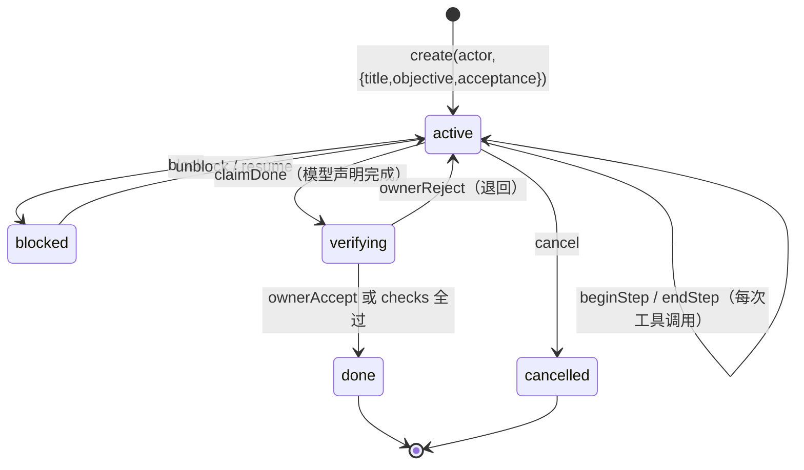

# K1 任务入口设计

状态：设计稿，待实现。2026-10-31。

## 问题

K1 有库无入口。`Ledger.create` 从未被调用——`grep "Ledger.open" src/` 的消费者只有 `supervisor.ts:311`、`main.ts:26/51`、`cli/prts.ts`，没有一处建任务。结果是：agent 跑完一整轮，`ledger_events` 表在真实运行中始终为空。

架构需求 §6 要求「状态只能由执行结果与验收写入」。没有任务，就没有可写入状态的对象。

## 结论

**任务必须显式创建，不能由对话自动派生。**

理由：`create` 要求 `title` / `objective` / `acceptance`（`ledger.ts:391-395`），其中 acceptance 强制二选一——`{kind:'checks'}` 或 `{kind:'owner-confirm'}`。聊天回合给不出这些。若按「每轮对话建一个 task」自动派生，会把闲聊写成任务，而账本是只追加哈希链，写错撤不回。

外部对照：DSH、deer-flow、Codex 都不做任务实体（Codex 的 `RolloutItem` 12 个变体里没有 Task）；天枢与 ruflo 有任务实体，但都在**显式创建**时才存在。PRTS 选了任务账本这条路，就必须补入口。

## 认知依据

人脑在这三件事上用的是三套分开的机制，不是一套账本。它们的结构直接约束了设计：

| 人脑机制 | 对设计的约束 |
|---|---|
| 情景记忆自动录制，不区分「任务」与「闲聊」 | 会话轨迹必须无差别记录（K4 审计 / rollout），**不能**因为它不属于某个任务就丢弃 |
| 目标靠前额叶持续激活维持，工作记忆容量约 4 个组块 | 目标必须外部化持有（K1）；同时 active 的任务数量要有上限，超限时明确拒绝而非静默排队 |
| 完成感来自奖赏预测，主观且已知会出错 | 模型只能 `claimDone`；结算必须来自可复现的 checks 或博士确认，不接受自我判定 |
| 未完成的意图保持更高激活（Zeigarnik 效应） | 未完成 / 阻塞的任务在恢复时要被优先呈现，不能静默沉底 |
| 前瞻记忆靠环境线索触发，不持续占用资源 | 阻塞的任务应挂事件条件，而不是每轮轮询检查 |
| 元记忆——知道自己「不记得」 | 校验器给不出确定结论时必须标 uncertain 并升级给人，不得默认通过 |

需要标注可信度：「PFC 持续性活动即目标表征」在文献里仍有争论（也有分布式表征的主张），这里按主流说法用作类比；其余几条（工作记忆容量、奖赏预测误差、Zeigarnik、前瞻记忆的线索触发）实证较扎实。**这些是设计动因，不是正确性证明**——写在这里是为了让后续改动知道为什么这么定，不要当教条引用。

## 谁能开任务

| 入口 | actor | 说明 |
|---|---|---|
| 博士显式命令 | `{kind:'owner'}` | 终端 `/task <objective>`，可带 acceptance |
| 模型工具调用 | `{kind:'model', sessionId}` | 工具 `prts_task_create`，经 `tools.guard` 判定；模型只能开 `owner-confirm` 或 `checks`，不能自成 owner |
| 自动检测多步执行 | — | **不做**。判据不可靠，会制造噪音任务 |

模型侧 actor 固定为 `{kind:'model', sessionId}`，且不暴露 `verify` / `ownerAccept` / `ownerReject` / `setBudget` / `stopByOwner` / `resumeFromStop` / `chargeUsage` / `recoverOnStartup`（AGENTS.md 的固定 actor 通道契约）。

## 容量与并发

对应工作记忆的容量限制——不是隐喻，是防止账本被压垮的工程约束：

- 同时处于 `active` 的任务默认上限 4 个（可配置）
- 达到上限时 `create` 返回明确错误，**不静默排队、不自动关闭旧任务**
- 检查在 `create` 内做（`list({phase:'active'}).length`），属于新增实现
- 因为不自动派生，正常使用中不会触发；一旦触发就说明有任务忘了收尾，应该让人看见

## 生命周期

状态迁移已按实现核对（`src/ledger/fold.ts:104-123`）：`task.done-claimed` 把 phase 置为 **`verifying`** 而非 `done`；`task.owner-accepted` 与 checks 全过才置 `done`。所以 `claimDone` 只是「声明完成」，结算发生在 `verifying` 阶段——这与 §4.4 第 3 条「模型最多只能声明完成」一致。

## 回合如何挂上去

任务处于 `active` 期间，订阅 `tools/result`（`dsh-tools/lib/types/index.d.ts:92`，emit 型、不阻塞）：

- 工具开始 → `beginStep(actor, taskId, {stepNo, name, idempotent, toolCallRef: callId})`
- 工具结束 → `endStep(actor, taskId, stepNo, {status: succeeded|failed, outputRef?})`

**没有活跃任务时不记**。这样纯聊天不产生账本事实，也不会为记账而建任务。

## 完成判定

与 §4.4 第 3 条对齐，库里已内建：

- `acceptance.kind === 'checks'` → 校验器跑 checks，全过则 `verifying → done`
- `acceptance.kind === 'owner-confirm'` → `claimDone` 后停在 `verifying`，等博士 `ownerAccept`

模型最多只能「声明完成」（`claimDone`），不能自己 `ownerAccept`。

**元记忆约束（需新增）**：校验器无法给出确定结论时（checks 超时、环境缺失、结果非确定），必须记 `uncertain` 并升级为 `owner-confirm`，不得默认通过。判定不了就说判定不了——这是「知道自己不记得」在工程上的对应物。

## 中断与恢复

- `TaskSnapshot.resume` 记录「停在哪里、下一步是什么」（§6 已有要求），由模型或博士在暂停/阻塞时写入
- 新会话启动时，把 `active` / `blocked` 的任务**列出来作为线索**，不自动恢复执行——对应前瞻记忆的线索触发，而不是后台轮询
- 恢复必须是显式动作（`resume`），不因为「上次没做完」就自动接着跑

## 不做

- 不自动从聊天派生任务
- 不做任务嵌套（子任务）
- 本轮不实现跨会话的上下文重建（只列任务线索）
- 不做后台轮询式的前瞻提醒——线索挂在事件上
- 不在 `tools/result` 里做失败重试或补偿——记账只记录已发生的事实

## 将来实现的验证方式

1. **红灯**：建一个 task → 用 scripted-llm 驱动一轮带 `write` 工具调用的对话 → 断言 `ledger.steps(taskId)` 为空（当前必然为空，因为根本没接线）
2. **绿灯**：同一场景下 `steps()` 有一条记录，`status === 'succeeded'`，`toolCallRef` 与 guard 审计里的 `callId` 对得上
3. **不产生噪音**：不建任务的纯聊天跑完后，`ledger.list()` 仍为空
4. **上限生效**：建满 4 个 active 任务后，第 5 次 `create` 返回明确错误

## 需要新增的实现（相对现有库）

| 项 | 位置 | 说明 |
|---|---|---|
| 任务创建入口 | `src/cli/` + `src/runtime/` | `/task` 命令 + `prts_task_create` 工具 |
| `tools/result` 订阅 | `src/runtime/start.ts` | `beginStep` / `endStep`，带活跃任务判定 |
| 并发上限检查 | `src/ledger/ledger.ts` 的 `create` | 默认 4，超限报错 |
| uncertain 结论 | `src/ledger/` + 校验器 | verifying 阶段的第三种结果 |
| 启动时列活跃任务 | `src/cli/chat-main.ts` | 只列出，不恢复 |
