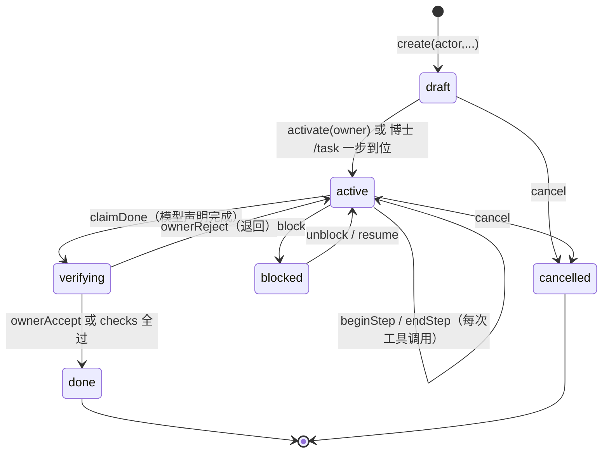

# K1 任务入口设计

状态：设计稿 v2（经议事会一轮审查后修订）。2026-10-31。

## 问题

K1 有库无入口。`Ledger.create` 从未被调用——`grep "Ledger.open" src/` 的消费者只有 `supervisor.ts:311`、`main.ts:26/51`、`cli/prts.ts`，没有一处建任务。结果是：agent 跑完一整轮，`ledger_events` 表在真实运行中始终为空。

架构需求 §6 要求「状态只能由执行结果与验收写入」。没有任务，就没有可写入状态的对象。

## 结论

**任务必须显式创建，不能由对话自动派生。**

真实理由只有一条：**账本是只追加哈希链，写进去撤不回来**。自动派生意味着模型的每次判断都可能把一条错误任务永久钉在链上，而任务语义（objective / acceptance）本该由人确定。

（上一版用的「聊天回合给不出 acceptance」站不住：模型完全可以生成 `file-exists` / `file-sha256` 的 checks，`ledger.ts:397-409` 只校验这两种。这个反例足以推翻那条理由，已撤换。）

外部对照：DSH、deer-flow、Codex 都不做任务实体（Codex 的 `RolloutItem` 12 个变体里没有 Task）；天枢与 ruflo 有任务实体，但都在显式创建时才存在。

## 认知依据（备忘，不是依据）

人脑把「记录经历」「维持目标」「判定完成」分成三套机制。**这张表是设计动因备忘，任何条目都不得作为唯一依据被引用**——真正的依据是下面的代码约束与工程理由。

| 人脑机制 | 观察到的对应做法 | 可信度 |
|---|---|---|
| 情景记忆自动录制，不区分任务与闲聊 | 轨迹无差别进 K4 审计，不因「不属于某任务」丢弃 | 实证较扎实 |
| 目标靠前额叶持续激活维持 | 目标外部化持有（K1） | 主流说法，仍有争论 |
| 完成感主观且已知会出错 | 模型只能 `claimDone`，结算靠 checks 或博士 | 实证较扎实 |
| 未完成意图保持高激活（Zeigarnik） | 未完成任务恢复时优先呈现 | 实证较扎实 |
| 前瞻记忆靠线索触发 | 阻塞任务挂事件条件，不轮询 | 实证较扎实 |

**上一版把「工作记忆约 4 个组块」推成「active 任务上限 4」，这条已删。** 数字是巧合，机制方向还相反：人脑的组块会自动衰减，账本不会。上限的真实理由是工程性的——防止无人收尾的僵尸任务污染启动线索的可读性。

## 谁能开任务

| 入口 | actor | 落库阶段 | 说明 |
|---|---|---|---|
| 博士显式命令 `/task` | `{kind:'owner'}` | `draft` → 立即 `activate` | 一步到位，直接 `active` |
| 模型工具 `prts_task_create` | `{kind:'model', sessionId}` | 仅 `draft` | **必须博士批准后才 `activate`**，不能自开自用 |
| 自动检测多步执行 | — | — | **不做**。判据不可靠 |

**`activate` 只由 owner 执行，不加入 `MODEL_OPS`**（`ledger.ts:115-118`）。模型建的任务停在 `draft`，等 `/task-approve <id>` 才进入 `active`。这样模型既不能给自己开任务，也不能绕过批准。

模型侧 actor 固定为 `{kind:'model', sessionId}`，且不暴露 `verify` / `ownerAccept` / `ownerReject` / `setBudget` / `stopByOwner` / `resumeFromStop` / `chargeUsage` / `recoverOnStartup`（AGENTS.md 固定 actor 通道契约）。

**防自证闭环**：模型建的任务**强制 `acceptance.kind = 'owner-confirm'`**，不接受模型自带 checks。否则「建任务 → 写文件 → claimDone → verifier 全过」会把「完成判定不来自模型」这条不变量从后门绕开（`CheckSpec` 的 `path` 目前也没做写权限交叉校验）。

**guard 判定目前是空的**：`prts_task_create` 会产生 `cap.tool('prts_task_create')`，而 `start.ts` 的适配器把 capabilities 过滤到 `fs.read/write/delete`，过滤后长度为 0 直接放行。所以「经 tools.guard 判定」这句在实现前是空话——要么给任务工具加显式能力判定，要么在工具自身入口做权限检查。这条必须在实现时二选一，不能留空。

## 任务归属（新，必须先定）

`tools/execute` / `tools/result` 只给 `exec.agent.session.id`，**没有 taskId**。没有绑定规则，多任务并存时 step 会记到错误的任务上，比不记更糟。

规则：

- 一个 session 同时最多绑定一个 `active` 任务
- 绑定关系记在账本（新事件 + fold 落地），不放 runtime 内存 Map——进程重启就丢，与 `recoverOnStartup` 语义不符
- 无绑定 session 的工具调用不记账

## 容量与并发

- 上限检查落在 **`activate`**（draft → active 那一刻），不在 `create`
- 统计口径：`phase IN ('draft','active')` 的总数，默认上限 4
- 检查在 `this.tx(...)` 事务内做，与 `transition` 一致；放在 `create` 的 tx 外是 TOCTOU
- **owner 通道不受上限约束**——博士正在推进的工作不能被账本策略挡住；上限只约束模型入口
- 超限用独立错误码，便于 CLI 给出引导（列出僵尸任务、提示 cancel），不用 `INVALID_INPUT`

## 生命周期

已按实现核对：

- `src/ledger/fold.ts:71` 的 `task.created` 分支 INSERT 的 phase 是 **`'draft'`**
- `TaskPhase` 包含 `'draft'`（`types.ts:11`）
- `activate` 从 `['draft']` 迁到 active（`ledger.ts:434`），**但 `src/` 内零调用者**——这是本设计要补的第一块
- `beginStep` 的 `checkStepGate` 只放行 `active`，所以任务停在 draft 时记账会抛 `INVALID_TRANSITION`
- `task.done-claimed` 置 `verifying` 而非 `done`（`fold.ts:104-105`）；`task.owner-accepted` 与 checks 全过才置 `done`

## 回合如何挂上去

**必须在 runtime 内打开 Ledger**——`start.ts` 当前只 open Authority（`grep Ledger src/runtime/start.ts` = 0），没有句柄，记账无处落。用与 supervisor 相同的 `core.sqlite`（`supervisor.ts:311`），并在 `dispose()` 里 `close()`（Windows 上 sqlite 句柄不关会锁文件，Authority 已踩过这个坑）。

挂点分两个，不能合并：

- **`beginStep` → `tools/execute`**（`dsh-tools/lib/types/index.d.ts:58`，waterfall，需 `next()`）：执行前、已放行、即将 dispatch。`tools/result`（`:92`）是执行后的 emit，拿不到「开始」信号，挂在那里会让 started 态事后才写，崩溃时无从观察
- **`endStep` → `tools/result`**（`:92`）

两个实现细节：

- **stepNo 分配**：并发工具调用共用计数器会撞 `UNEXPECTED_STEP`，需要 per-task 单调分配器（`steps().length + 1` 或持久计数器）
- **钩子内全程 try/catch**：ledger 抛错（`INVALID_TRANSITION` / `UNEXPECTED_STEP`）不能污染工具派发。记账失败是缺陷，否决工具执行是事故——失败只上报 `agent/error`

**没有活跃任务时不记**。步骤表不是会话时间线；会话时间线归 K4 审计与会话日志。

## 完成判定

与 §4.4 第 3 条对齐，库里已内建：

- `acceptance.kind === 'checks'` → 校验器跑 checks，全过则 `verifying → done`
- `acceptance.kind === 'owner-confirm'` → `claimDone` 后停在 `verifying`，等博士 `ownerAccept`

模型最多「声明完成」，不能 `ownerAccept`。

**`uncertain` 本轮不做。** 上一版设计的「checks 超时、环境缺失」在现有 `CheckSpec` 下**不可达**——只有 `file-exists` / `file-sha256`（`types.ts:20-22`），同步且确定性。要支持不确定，得先扩展 CheckSpec（如 `command-exit`），再新增事件种类 + fold 分支 + perm 白名单 + `TaskPhase` 变更，且必须过 `rebuildProjections` 的重放一致性。这是一个独立设计，不塞进本方案。

## 中断与恢复

- `TaskSnapshot.resume` 记录「停在哪里、下一步是什么」（§6 已有要求）
- 新会话启动时列出 **`draft`（待批准）/ `active` / `blocked`** 三类任务作为线索——`draft` 与 `recoverOnStartup` 标记的 unknown step 才是真正需要人裁决的
- 只列出，不自动恢复；恢复必须显式 `resume`
- 列表由 runtime 暴露只读查询后在 CLI 打印，不在 CLI 里另开 Ledger 连接

## 实现顺序（前置依赖已排好）

| 波次 | 内容 | 为什么是这个顺序 |
|---|---|---|
| W0 | `startRuntime` 打开/关闭 Ledger（与 supervisor 同库） | 没有句柄，后面全部无处落 |
| W1 | draft→activate 语义 + 并发上限（放 activate，事务内） | 不先定，记账会撞 `INVALID_TRANSITION`，验收必红 |
| W2 | session↔task 绑定（账本事件 + 查询） | 不先定，多任务时 step 会记错对象 |
| W3 | `beginStep` 挂 `tools/execute`、`endStep` 挂 `tools/result` | 依赖 W0/W1/W2 |
| W4 | 入口：`/task`、`/task-approve`、`prts_task_create`（含权限判定二选一） | 依赖 W1 |
| W5 | 启动列出 draft/active/blocked | 依赖 W0 |

每波独立提交，每波跑 `npm test` 与 `npx tsc -p .`。

## 不做

- 不自动从聊天派生任务
- 不做任务嵌套
- 不做后台轮询式前瞻提醒——线索挂事件
- 不实现 `uncertain`（等 CheckSpec 扩展，独立设计）
- 本轮不做跨会话上下文重建（只列线索）
- 不在记账钩子里做失败重试或补偿——只记录已发生的事实

## 验证方式

1. **draft 断言**：`create` 后 `get(id).phase === 'draft'`；`activate` 后才 `active`（避免只有端到端测试才发现任务全沉在 draft）
2. **红灯**：建 task 并 activate → scripted-llm 驱动一轮带 `write` 的对话 → `ledger.steps(taskId)` 为空（当前必然为空）
3. **绿灯**：同场景下 `steps()` 有一条记录，`status === 'succeeded'`，`toolCallRef` 与 guard 审计的 `callId` 对得上
4. **不产生噪音**：纯聊天跑完 `ledger.list()` 仍为空
5. **上限生效**：模型建满上限后第 N+1 次 `create`/`activate` 返回独立错误码；owner 通道不受限
6. **并发不串号**：同一任务两个并发工具调用，stepNo 不冲突、不撞 `UNEXPECTED_STEP`
