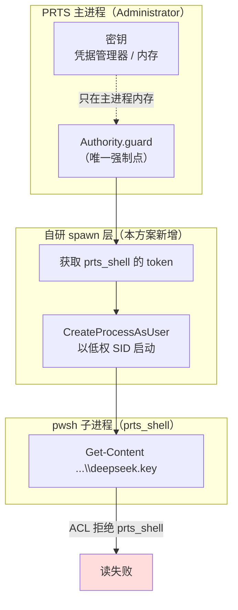

# U3：密钥读隔离方案（待架构决策）

**状态：方案存档，未实施。** 2026-10-31。

本文记录「让模型 shell 读不到 `C:\prts-data\secrets\deepseek.key`」这件事的完整探索结论：
四条系统层路径已逐一实测证伪，只剩一条需要自研的重方案。**建议不在当前迭代做**，理由见末节。

---

## 1. 目标与非目标

**目标**：`pwsh` 工具（模型经 shell）读取 `C:\prts-data\secrets\deepseek.key` 被拒。
**非目标**：不防 PRTS 主进程自身出错；不防用户手动查看；不引入容器。

当前状态（提交 `940cc4b`）：明文密钥文件已不再是必需的——`src\cli\secret.ts` 优先从 Windows 凭据管理器取。
**但**如果用户保留了明文文件作为回退，shell 仍能 `Get-Content` 读走它。

---

## 2. 四条已证伪的路径（全部实测，附证据）

### 2.1 换 `dsh-pwsh-sandbox` —— 无读隔离收益

- 该包自述：**"Sandbox-consuming"**，消费 `ctx.sandbox`，不自己造隔离
- Windows 后端是 `dsh-sandbox-windows-acl`，其 `lib/runner.js:8-9` 写明：「creates the **WRITE_RESTRICTED** token with the workspace write-SID allowlist」
- 实测（`.scratch\probe-pwsh.test.ts`）：越界写被拒（`UnauthorizedAccessException`），读 `dataRoot\secrets\` 下的文件**完全不拦**

**结论**：只限写，不限读。换包等于把已有能力再套一遍。

### 2.2 SACL + 完整性标签 `no-read-up` —— 本机环境写不进

沙箱进程是 Low IL（`S-1-16-4096`），宿主是 Medium（`.scratch\probe-il.test.ts`）。原理上 `NR` 策略能精确区分两者，但：

| 尝试 | 结果 |
|---|---|
| 提权进程 `SeSecurityPrivilege` | **有**（`whoami /priv` 实测） |
| `AdjustTokenPrivileges` 启用后 `SetNamedSecurityInfoW` | `rc=0`，回读无 `S:` 段 |
| 独立工具 `icacls /setintegritylevel High` | 报「已成功处理」，回读无 `Mandatory Label` |
| 最终判据：Low IL 子进程读副本 | **读到 35 字节**（`.scratch\probe-il-read.test.ts`） |

**结论**：不是权限不足，不是 API 用错，是环境静默吞掉 SACL 写入。

### 2.3 deny ACE 打 `workspaceWriteSid` —— ACE 进去了但不生效

原理：restricted token 的访问检查要求「normal SID 允许 AND restricting SID 允许」，若 restricting SID 被 deny 就能精确拦住沙箱。

实测（`.scratch\probe-deny-sid.test.ts`）：

```
workspace SID = S-1-4-1067751353-21736669
DACL 实际内容 = [..., "S-1-4-1067751353-21736669:(DENY)(Rc,RD,REA,RA)", ...]
AFTER-deny exit=0 bytes=22        ← 沙箱照样读到
```

**结论**：ACE 确实写进了 DACL，但该 SID 在沙箱 token 里不参与读检查——它只是 workspace 的写授权 SID。

### 2.4 DACL deny 打 Administrator —— 会同时锁死 PRTS

shell 与 PRTS 是同一 SID（`S-1-5-21-...-500`，H3 探针实测）。deny 对该 SID 的所有进程一视同仁。

**结论**：不可行，且危险。

### 2.5 换身份 —— 现有包不支持

`AclSandbox` 构造参数只有 `writableDirs` / `tempDir` / `writeSid` / `mode` / `manageDacls`，**无 user/token**。它只用当前身份派生 restricted token。

---

## 3. 唯一剩余路径：专用账号 + 自研 spawn 层



**核心判断**：隔离边界必须从「同一 SID 的 token 限制」换成「**不同 SID**」。只有换身份，ACL 才有意义。

参考样本：本机 `CodexSandboxUsers` 组（注释「Codex sandbox internal group (managed)」）下挂着 `CodexSandboxOffline` / `CodexSandboxOnline` 两个专用账号——天枢运行时就是这么做的。

---

## 4. 分波（如果决定实施）

### Wave 0：可行性探针（30 分钟，必须先做）

三个断言，任一失败即止步：

1. 能否创建本地账号 `prts_shell`
2. **能否在不持有明文密码的前提下拿到该账号 token**
3. 能否用该 token 启动 pwsh 并让它正常执行命令

**验证命令**：
```sh
node --test --test-force-exit .scratch/probe-shell-identity.test.ts
```
**判据**：子进程 `whoami /user` 返回 `prts_shell` 的 SID，而非 `S-1-5-21-...-500`。

### Wave 1：账号与 ACL（一次性，需提权，不可逆）

```powershell
# 先备份 SDDL
(Get-Acl 'C:\prts-data\secrets\deepseek.key').Sddl | Out-File acl-backup.txt
net user prts_shell <random> /add /comment:"PRTS model shell"
icacls 'C:\prts-data\secrets\deepseek.key' /remove "prts_shell"
icacls 'C:\prts-data\secrets\deepseek.key' /remove "Users"
icacls 'C:\prts-data\secrets\deepseek.key' /remove "Authenticated Users"
```

**验证**：`icacls` 回读确认 `prts_shell`/`Users` 都不在 ACL；同时 PRTS 的 `readFileSync` 仍能读。

### Wave 2：spawn 层

新增 `src\runtime\shell-spawn.ts`，用 `CreateProcessAsUser` 替代 `AclSandbox.spawn`。**不改 `node_modules`**——包一层自己的启动器。

**验证**：
```sh
node --test --test-force-exit test/runtime/guard-wiring.test.ts
npm test
```
**判据**：现有用例全绿（pwsh 相关不能因换身份而红），且新增「shell 读密钥被拒」用例绿。

### Wave 3：回归与文档

`npm test` + `npx tsc -p .`，更新 `PRTS-INDEX.md` §5 第 2 条。

---

## 5. 反证（瑶光章节）

**方案可能撞上的最小反例**：`CreateProcessAsUser` 通常需要该账号的**明文密码**（`LogonUser`）或一个已登录会话的 token。若密码必须存在某处供 PRTS 读取，那密码本身又成了可读凭据——只是把问题挪了一层。

**预判的出路**：Windows 的正解是让 PRTS **以服务形式运行**（服务账号密码由 SCM 保管，应用无需知道），再由服务派生 shell。若真走这条，工作量翻倍。**这一点未验证**，是 Wave 0 必须回答的第一个问题。

**其他已知风险**：
- 换身份后 pwsh 的 `$PROFILE`、临时目录、文件所有权都会变，`runtime.test.ts` 的 R2 用例可能红
- 账号密码策略 / 过期会破坏长期可用性
- `C:\prts-data\secrets\` 目录本身可能也需要调整 ACL，否则 shell 仍能列目录

---

## 6. 为什么建议现在不做

| | 收益 | 代价 |
|---|---|---|
| 做完 U3 | 防住「同用户进程主动调 `CredRead` 或读文件」 | 新账号 + 自研 spawn 层 + 可能改服务形态 + 全量回归 + 长期密码管理 |
| 现状（`940cc4b`） | 已消除「明文文件被 `Get-Content` 随手读走」 | — |

剩下的威胁是「模型主动写代码提取凭据」。这个场景要求模型要么已完全失控（那时它还能做别的），要么提示注入复杂到能驱动多步代码执行。

**推荐**：等 K2b 正式立项时，连同容器方案一起评估。当前把精力放在功能推进上。

---

## 7. 复现全部结论

```sh
cd C:\prts-system
node --test --test-force-exit .scratch/probe-pwsh.test.ts        # 写被拒、读放行
node --test --test-force-exit .scratch/probe-il.test.ts          # 沙箱是 Low IL
node --test --test-force-exit .scratch/probe-il-read.test.ts     # SACL 未生效的判据
node --test --test-force-exit .scratch/probe-deny-sid.test.ts    # deny ACE 不生效
```

`.scratch\` 已被 gitignore，这些探针不参与 `npm test`。
